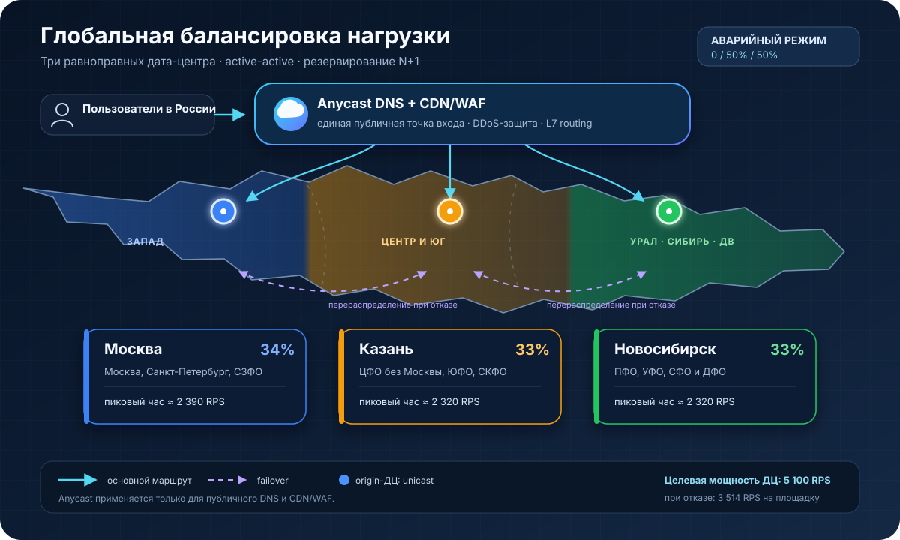
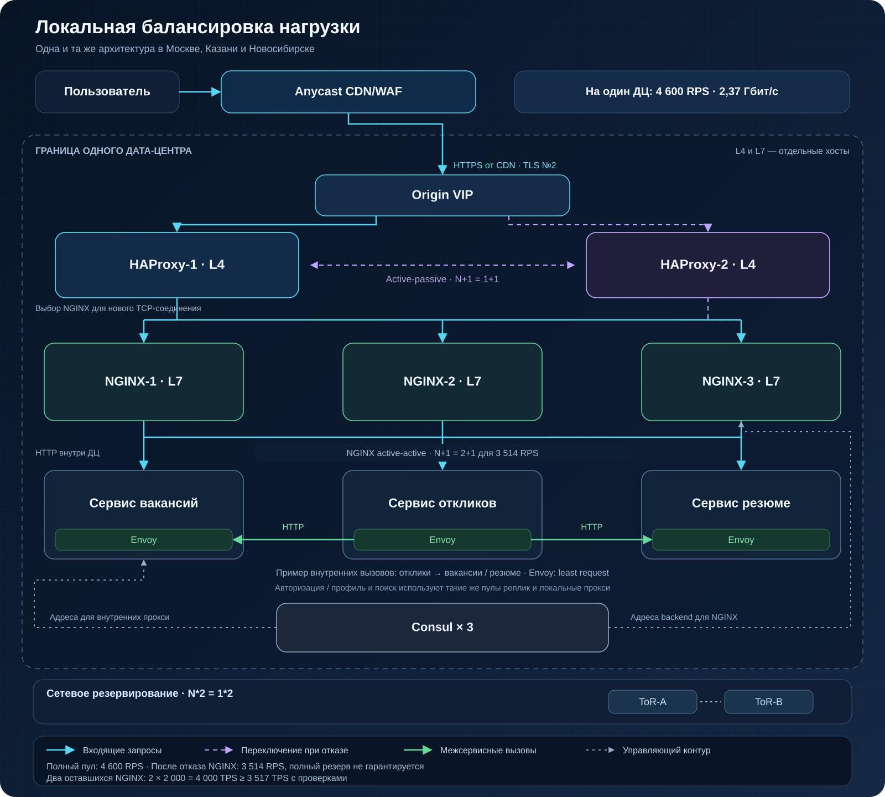
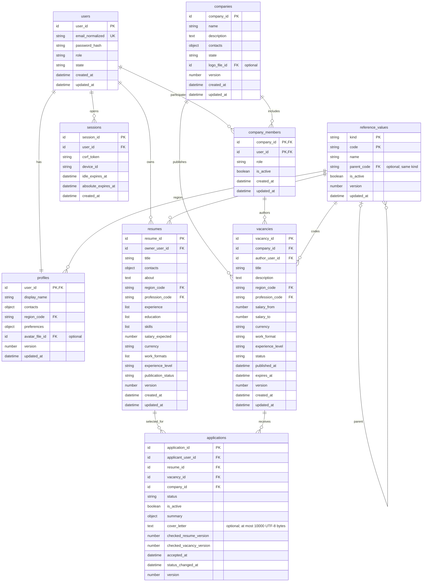
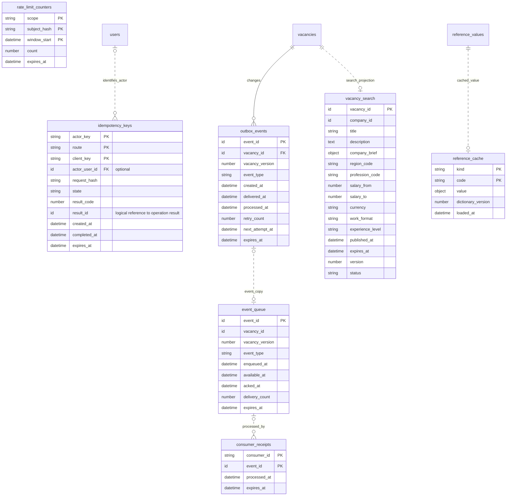
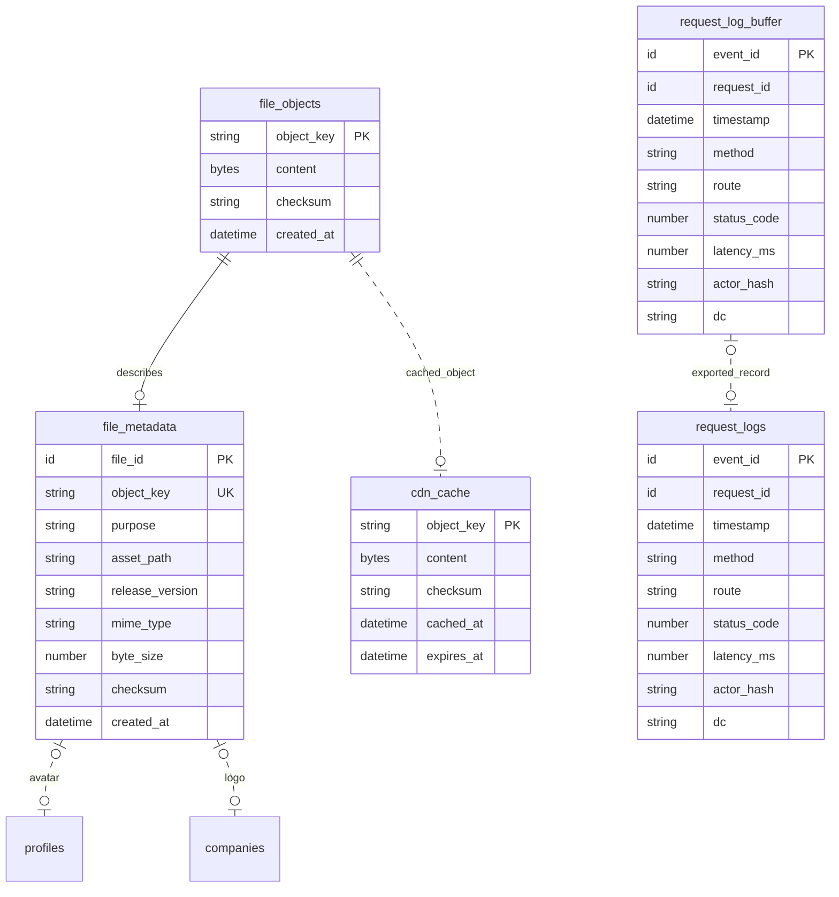
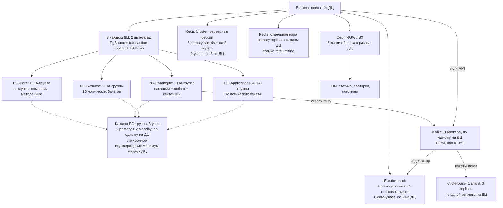
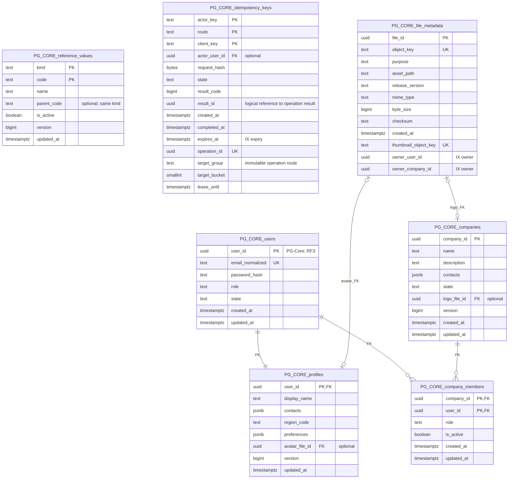
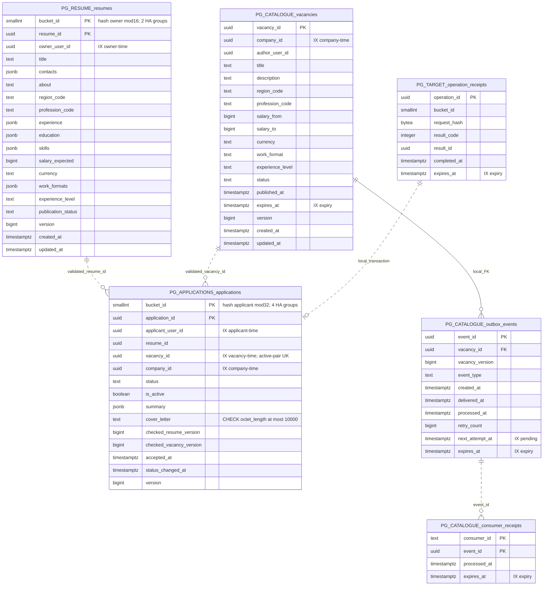
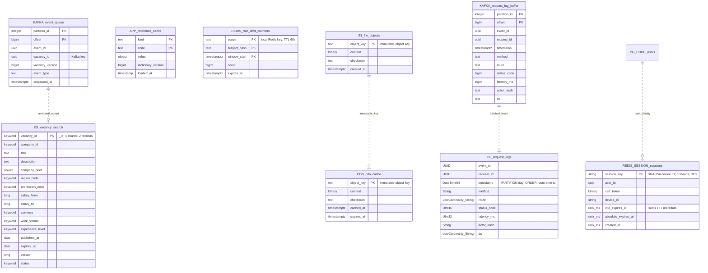

# Высоконагруженная платформа онлайн-рекрутинга для поиска работы и сотрудников

Курсовая работа по курсу «Проектирование высоконагруженных систем».

## 1. Тема и целевая аудитория

### Тема

Высоконагруженная платформа онлайн-рекрутинга для поиска работы и сотрудников. Ближайший аналог – HeadHunter

### Целевая аудитория

Основная аудитория сервиса состоит из двух групп:

- соискатели — пользователи, которые создают резюме, ищут вакансии и отправляют отклики;
- работодатели и рекрутеры — представители компаний, которые публикуют вакансии, ищут специалистов и обрабатывают отклики.

В качестве ориентира по масштабу используется hh.ru. Месячная активная аудитория платформы около 33 млн человек, общее число зарегистрированных пользователей составляет около 60 млн [[1]](#source1). География MVP — Российская Федерация. Сервис должен учитывать регион пользователя и поддерживать поиск по всей стране: открытая статистика hh.ru охватывает 84 региона России [[2]](#source2). Ядро аудитории hh.ru составляют пользователи в возрасте от 25 до 44 лет — на них приходится около 60% аудитории. Ежедневная аудитория мобильного приложения превышает 2,3 млн соискателей, а месячная — 11,2 млн [[3]](#source3).

### Функционал MVP

1. Регистрация и авторизация пользователей в роли соискателя или работодателя.
2. Создание, редактирование и публикация резюме.
3. Создание, редактирование и публикация вакансий.
4. Поиск и просмотр вакансий с фильтрацией по профессии, региону, формату работы, опыту и уровню дохода.
5. Отправка отклика на вакансию с выбором резюме и необязательным текстовым сопроводительным письмом.
6. Просмотр соискателем отправленных откликов и их текущих статусов.
7. Просмотр работодателем откликов, резюме и сопроводительных писем кандидатов, изменение статуса отклика и отправка приглашения или отказа.

### Ключевые продуктовые решения

1. Сервис поддерживает две основные роли: соискатель работает с резюме и откликами, а работодатель с вакансиями и кандидатами.
2. Поиск вакансий выполняется по названию и описанию с возможностью фильтрации по региону, профессии, формату работы, опыту и уровню дохода. По умолчанию вакансии сортируются по дате публикации.
3. Отклик можно отправить только с опубликованным резюме. Для каждой пары «вакансия — резюме» допускается только один активный отклик.
   Сопроводительное письмо передаётся текстом в том же запросе отправки отклика; лимит — 10 000 байт в UTF-8, без загрузки отдельного файла. После отправки текст письма сохраняется вместе с откликом и не меняется при редактировании резюме.
4. Работодатель получает доступ к данным кандидата в рамках отклика и управляет воронкой подбора через статусы: «На рассмотрении», «Приглашение» и «Отказ».
5. Поиск вакансий должен поддерживать полнотекстовый поиск, фильтрацию и сортировку.

## 2. Расчёт нагрузки

Расчёт выполнен для нагрузки, сопоставимой с российским сегментом hh.ru. Публичные показатели отмечены ссылками на источники, остальные значения являются проектными допущениями.

### 2.1. Продуктовые метрики

#### Аудитория и объём контента

| Метрика | Значение | Основание |
|---|---:|---|
| Месячная аудитория (MAU) | 33 млн пользователей | Данные HeadHunter [[1]](#source1) |
| Дневная аудитория (DAU) | 6,8 млн пользователей | Расчёт по коэффициенту `DAU / MAU = 2,3 / 11,2 ≈ 20,5%` для мобильного приложения [[3]](#source3) |
| DAU соискателей | 6,46 млн пользователей | Проектное допущение: 95% DAU |
| DAU работодателей | 0,34 млн пользователей | Проектное допущение: 5% DAU |
| Зарегистрированные пользователи | 60 млн | Данные HeadHunter [[1]](#source1) |
| Новые регистрации | 33 тыс. в сутки | Проектное допущение: равномерный набор 60 млн пользователей за пять лет, `60 млн / (5 × 365)` |
| Резюме | 79,6 млн | Данные на 31 января 2026 года [[4]](#source4) |
| Зарегистрированные компании | 2,67 млн | Данные на 31 января 2026 года [[4]](#source4) |
| Одновременно активные вакансии | 778 тыс. | Данные на 31 января 2026 года [[4]](#source4) |
| Новые публикации вакансий | 25,9 тыс. в сутки | `778 367 / 30 дней`; публикация вакансии действует 30 дней [[5]](#source5) |
| Новые отклики | 620 тыс. в сутки | `25 946 × 23,9`; публичная метрика включает отклики и звонки, поэтому всё значение принято за отклики как верхняя оценка [[4]](#source4) |

Для оценки DAU отношение дневной и месячной аудитории мобильного приложения переносится на всю аудиторию сервиса. Это допущение даёт `33 млн × 20,5% ≈ 6,8 млн` активных пользователей в сутки.

Публичного распределения DAU по ролям нет. В качестве приближения использовано соотношение 60 млн зарегистрированных пользователей и 2,67 млн зарегистрированных компаний: `60 / (60 + 2,67) ≈ 95,7%` и `2,67 / (60 + 2,67) ≈ 4,3%`. Для дальнейших расчётов пропорция округлена до 95% соискателей и 5% работодателей. Компания при этом не равна отдельному аккаунту рекрутера, поэтому такое распределение является проектным допущением, а не статистикой hh.ru.

#### Действия пользователей

| Роль | Действие | В среднем на одного активного пользователя в сутки | Всего в сутки | Тип операции |
|---|---|---:|---:|---|
| Все пользователи | Авторизация или обновление сессии | 1 | 6,8 млн | Чтение + запись |
| Соискатель | Поиск вакансий и применение фильтров | 5 | 32,3 млн | Чтение |
| Соискатель | Просмотр карточки вакансии | 12 | 77,52 млн | Чтение |
| Соискатель | Создание или изменение резюме | 0,02 | 129,2 тыс. | Запись |
| Соискатель | Отправка отклика | 0,096 | 620 тыс. | Запись |
| Соискатель | Просмотр списка своих откликов | 1 | 6,46 млн | Чтение |
| Работодатель | Создание или изменение вакансии | 0,15 | 51,9 тыс. | Запись |
| Работодатель | Просмотр списка входящих откликов | 5 | 1,7 млн | Чтение |
| Работодатель | Просмотр резюме из отклика | 1,28 | 434 тыс. | Чтение |
| Работодатель | Изменение статуса отклика | 1,09 | 372 тыс. | Запись |

Частота поисков и просмотров является проектным допущением. Предполагается, что работодатель просматривает 70% поступивших резюме и изменяет статус у 60% откликов.

#### Расчётный объём данных пользователя

В MVP резюме, вакансии и отклики хранятся как структурированный текст. Загрузка портфолио, видео и других тяжёлых вложений не предусмотрена.

Для проектирования приняты консервативные логические размеры объектов: учётная запись и профиль — `100 Кбайт`, резюме — `100 Кбайт`, вакансия — `50 Кбайт`, карточка компании — `50 Кбайт`, отклик с сопроводительным письмом — `11 Кбайт`: `1 Кбайт` на связи, статус и краткие сведения плюс до `10 Кбайт` на текст письма. Для запаса в объёмах и трафике каждому отклику выделен полный бюджет письма, хотя оно необязательно; это не измеренный средний размер. Остальные размеры также являются проектными оценками, а не измерениями hh.ru или размерами PDF. Оценка профиля в 100 Кбайт относится ко всей совокупности структурированных данных аккаунта, настроек и предпочтений. Изображения, файловые вложения, индексы СУБД, репликация и резервные копии в эти размеры не входят.

В таблицах объём на пользователя приведён в Кбайт. Среднее количество объектов показано с округлением, но объёмы и итоги рассчитаны из исходных количеств до округления.

| Сущность соискателя | Среднее количество | Расчётный размер объекта с запасом | Объём на пользователя |
|---|---:|---:|---:|
| Учётная запись и профиль | 1 | 100 Кбайт | 100 Кбайт |
| Резюме | ≈ 1,33 | 100 Кбайт | 132,67 Кбайт |
| Отклики за пять лет с письмами | ≈ 18,86 | 11 Кбайт | 207,47 Кбайт |
| **Итого** | — | — | **440,14 Кбайт** |

Среднее количество резюме на одного соискателя рассчитано как `79 600 000 / 60 000 000 ≈ 1,33`. За пять лет в системе накапливается `620 099 × 365 × 5 = 1 131 680 675` откликов, поэтому на одного зарегистрированного пользователя приходится `1 131 680 675 / 60 000 000 ≈ 18,86` отклика. Расчётный логический объём данных одного соискателя равен `100 + (79 600 000 / 60 000 000) × 100 + (1 131 680 675 / 60 000 000) × 11 ≈ 440,14 Кбайт`, или около `0,000440 Гбайт`, без изображений и поисковых индексов.

Для работодателей объём данных оценивается на одну зарегистрированную компанию.

| Сущность работодателя | Среднее количество | Расчётный размер объекта с запасом | Объём на компанию |
|---|---:|---:|---:|
| Карточка компании | 1 | 50 Кбайт | 50 Кбайт |
| Вакансии за пять лет | ≈ 18,03 | 50 Кбайт | 901,31 Кбайт |
| Полученные отклики за пять лет с письмами | ≈ 423,85 | 11 Кбайт | 4 662,35 Кбайт |
| **Итого** | — | — | **5 613,66 Кбайт** |

Количество активных и исторических вакансий за пять лет составляет `778 367 + 25 946 × 365 × 5 = 48 129 817`. Среднее количество вакансий на одну компанию равно `48 129 817 / 2 670 000 ≈ 18,03`, полученных откликов — `1 131 680 675 / 2 670 000 ≈ 423,85`. Расчётный логический объём данных одной компании равен `50 + (48 129 817 / 2 670 000) × 50 + (1 131 680 675 / 2 670 000) × 11 ≈ 5 613,66 Кбайт`, или около `0,005614 Гбайт`, без изображений и поисковых индексов.

Отклик связывает вакансию и резюме по идентификаторам и содержит статус, даты и текст сопроводительного письма. Полная копия резюме и переписка в него не включаются. В пользовательских таблицах один и тот же отклик рассматривается со стороны соискателя и компании, а в общем хранилище ниже учитывается один раз вместе с письмом.

### 2.2. Технические метрики

#### Хранилище

Для исторических вакансий и откликов принят горизонт хранения пять лет. В таблице указаны расчётные логические объёмы основных сущностей и отдельная предварительная оценка поискового индекса; репликация, резервные копии и служебные данные СУБД не включены. Итоги вычислены из исходных количеств объектов до округления.

| Тип данных | Количество объектов | Расчётный размер объекта с запасом | Объём |
|---|---:|---:|---:|
| Пользователи | 60 000 000 | 100 Кбайт | 6,000 Тбайт |
| Резюме | 79 600 000 | 100 Кбайт | 7,960 Тбайт |
| Компании | 2 670 000 | 50 Кбайт | 0,134 Тбайт |
| Активные и исторические вакансии за пять лет | 48 129 817 | 50 Кбайт | 2,406 Тбайт |
| Отклики с сопроводительными письмами за пять лет | 1 131 680 675 | 11 Кбайт | 12,448 Тбайт |
| Поисковый индекс активных вакансий | 778 367 документов | 40 Кбайт | 0,031 Тбайт |
| **Итого** | — | — | **28,980 Тбайт** |

Например, резюме требуют `79 600 000 × 100 × 10³ / 10¹² = 7,960 Тбайт`, вакансии — `48 129 817 × 50 × 10³ / 10¹² ≈ 2,406 Тбайт`, а отклики с письмами — `1 131 680 675 × 11 × 10³ / 10¹² ≈ 12,448 Тбайт`. Основные сущности занимают около `28,948 Тбайт`; вместе с предварительной оценкой поискового индекса — `28,980 Тбайт`. Письмо учтено внутри отклика, отдельный второй объём на него не добавляется.

Оценка поискового индекса увеличена пропорционально пятикратному росту расчётного размера вакансии: `8 × (50 / 10) = 40 Кбайт` на активную вакансию. Это предварительное проектное приближение, а не гарантированное соотношение размеров документа и индекса. Фактический размер зависит от индексируемых полей, хранения исходного документа, анализаторов и настроек поискового движка; его нужно уточнить на пробном индексе. Физический объём с учётом репликации, индексов СУБД и резервных копий будет рассчитан при проектировании физической схемы данных.

Эта оценка охватывает основные продуктовые сущности и поисковый индекс. Детализация аккаунта и дополнительные данные — сессии, членство в компаниях, служебные кеши, очереди, статика и технические журналы — отдельно рассчитаны в разделе 5; они не входят в приведённые здесь 28,980 Тбайт.

#### RPS

Среднесуточный RPS рассчитывается по формуле `количество операций в сутки / 86 400`. Сумма суточных объёмов всех операций, включая регистрацию, составляет `126 420 100` запросов, поэтому среднесуточная нагрузка равна `126 420 100 / 86 400 ≈ 1 463,20 RPS`.

Суточное количество запросов само по себе не определяет пиковую нагрузку: для этого нужно знать распределение операций во времени. Поскольку измерений нагрузки проектируемого сервиса нет, рассматриваются три сценария концентрации суточных запросов в наиболее загруженный час. Доля этого часа обозначается `p`:

```text
Запросов в наиболее загруженный час = запросов в сутки × p
RPS в наиболее загруженный час = запросов в сутки × p / 3 600
```

| Сценарий | Доля суточных запросов в одном часе | Запросов за этот час | Средний RPS за этот час |
|---|---:|---:|---:|
| Концентрация 10% | 10% | 12 642 010 | 3 511,67 |
| Концентрация 15% | 15% | 18 963 015 | 5 267,50 |
| Концентрация 20% — выбран для проектирования | 20% | 25 284 020 | 7 023,34 |

Для проектирования выбран наиболее напряжённый из рассмотренных сценариев: система должна обслуживать до 20% расчётного суточного количества операций за один час. Остальные 80% операций приходятся на остальные 23 часа; их конкретное распределение в этой модели не задаётся. Значение 20% является проектным допущением и требованием к сценарию нагрузки, а не измеренной статистикой hh.ru. Таблица показывает чувствительность результата к этому допущению, но не доказывает фактическую долю пикового часа.

Например, для поиска вакансий расчёт даёт `32 300 000 × 0,20 / 3 600 ≈ 1 794,44 RPS`. Для таблицы и дальнейшего расчёта мощности каждый тип операции округляется вверх до целого числа: поиск — до `1 795 RPS`. Сумма округлённых значений составляет `7 028 RPS`, тогда как суммарная оценка до округления — `7 023,34 RPS`. Среднесуточные значения в таблице округлены до двух знаков; итог вычислен из неокруглённых значений.

| Тип запроса | Запросов в сутки | Среднесуточный RPS | Расчётный RPS пикового часа, округление вверх |
|---|---:|---:|---:|
| Регистрация | 33 000 | 0,38 | 2 |
| Авторизация и обновление сессии | 6 800 000 | 78,70 | 378 |
| Поиск вакансий | 32 300 000 | 373,84 | 1 795 |
| Просмотр вакансии | 77 520 000 | 897,22 | 4 307 |
| Создание или изменение резюме | 129 200 | 1,50 | 8 |
| Отправка отклика | 620 000 | 7,18 | 35 |
| Просмотр своих откликов | 6 460 000 | 74,77 | 359 |
| Создание или изменение вакансии | 51 900 | 0,60 | 3 |
| Просмотр входящих откликов | 1 700 000 | 19,68 | 95 |
| Просмотр резюме кандидата | 434 000 | 5,02 | 25 |
| Изменение статуса отклика | 372 000 | 4,31 | 21 |
| **Итого** | **126 420 100** | **1 463,20** | **7 028** |

Для каждой операции принято одинаковое распределение во времени: 20% её суточного объёма приходится на один и тот же пиковый час. Это дополнительное допущение позволяет суммировать нагрузку разных типов запросов. В выбранном сценарии отношение RPS пикового часа к среднесуточному RPS до округления равно `0,20 × 86 400 / 3 600 = 4,8`; оно следует из доли часа, а не задаётся отдельным коэффициентом.

Полученный RPS характеризует среднюю интенсивность в наиболее загруженный час, а не максимальное количество запросов за отдельную секунду. Кратковременные всплески внутри часа не оценены этой моделью. Запас мощности и резервирование рассчитываются отдельно в разделе 3; способность выдерживать расчётную нагрузку и короткие всплески должна проверяться нагрузочным тестированием. После запуска доля пикового часа уточняется по мониторингу.

#### Сетевой трафик

Расчётные размеры обмена согласованы с размерами объектов выше. Для регистрации с передачей полного профиля и для создания или изменения полного резюме принято `100 + 5 = 105 Кбайт` на запрос и ответ вместе. Для просмотра работодателем резюме вместе с сопроводительным письмом принято `100 + 10 + 5 = 115 Кбайт`; это тот же API-вызов, а не дополнительный запрос. Для отправки отклика с письмом — `11 + 2 = 13 Кбайт`. Для создания, изменения или просмотра полной вакансии принято `50 + 5 = 55 Кбайт`. Дополнительные байты учитывают представление ответа, параметры и сопутствующий небольшой запрос. Изменения консервативно считаются передачей полного объекта; частичные обновления могут быть меньше. Эти размеры не являются измеренными средними значениями.

Поисковая выдача включает одну страницу из 20 кратких представлений вакансий: `20 × 2,5 = 50 Кбайт`, без полного описания каждой вакансии. Списки откликов содержат идентификаторы, статусы и краткие сведения, но не полный текст писем, резюме или карточки компаний; для них сохранены оценки 30 и 40 Кбайт на страницу. Письмо возвращается только при открытии отклика вместе с резюме. Изменение статуса не пересылает текст письма. Авторизация и обновление сессии передают данные входа, session cookie и CSRF-токен; для этого обмена сохранён бюджет 3 Кбайт. Карточка компании не имеет отдельного типа запроса в текущей модели MVP; в ответах вакансий учитывается только краткое представление компании.

Размеры запросов и ответов учитываются до HTTP-сжатия. Статические ресурсы приложения предполагается отдавать через CDN и кеш браузера; изображения и файловые вложения в эту оценку не входят.

Сетевой трафик рассчитывается по той же модели пикового часа: `объём данных в сутки × 0,20 / 3 600`. Для перевода байт в Гбит/с результат умножается на `8 / 10⁹`. Например, поисковая выдача требует `1 615 × 10⁹ × 0,20 / 3 600 × 8 / 10⁹ ≈ 0,718 Гбит/с`. Для сетевых расчётов используются суточные объёмы операций до округления RPS, итоговые значения вычисляются до округления отдельных строк.

| Тип трафика | Расчётный объём запроса и ответа | Объём в сутки | Пропускная способность в пиковый час |
|---|---:|---:|---:|
| Регистрация | 105 Кбайт | 3,465 Гбайт | 0,002 Гбит/с |
| Авторизация и сессии | 3 Кбайт | 20,4 Гбайт | 0,009 Гбит/с |
| Поисковая выдача вакансий | 50 Кбайт | 1 615 Гбайт | 0,718 Гбит/с |
| Карточки вакансий | 55 Кбайт | 4 263,6 Гбайт | 1,895 Гбит/с |
| Создание и изменение резюме | 105 Кбайт | 13,566 Гбайт | 0,006 Гбит/с |
| Отклики с сопроводительными письмами | 13 Кбайт | 8,06 Гбайт | 0,004 Гбит/с |
| Списки откликов соискателя | 30 Кбайт | 193,8 Гбайт | 0,086 Гбит/с |
| Создание и изменение вакансий | 55 Кбайт | 2,855 Гбайт | 0,001 Гбит/с |
| Списки откликов работодателя | 40 Кбайт | 68 Гбайт | 0,030 Гбит/с |
| Просмотр резюме и письма работодателем | 115 Кбайт | 49,91 Гбайт | 0,022 Гбит/с |
| Изменение статусов откликов | 2 Кбайт | 0,7 Гбайт | <0,001 Гбит/с |
| **Итого без запаса** | — | **6 239 Гбайт/сутки** | **2,773 Гбит/с** |
| **Требуемая пропускная способность с запасом 1,3** | — | — | **3,61 Гбит/с** |

Суммарный расчётный объём составляет `6 239,3995 Гбайт/сутки`, пропускная способность пикового часа — `6 239,3995 × 0,20 / 3 600 × 8 ≈ 2,773066 Гбит/с`. С 30%-м запасом получается `2,773066444… × 1,3 ≈ 3,604986 Гбит/с`, округлённые вверх до `3,61 Гбит/с`. Добавление письма увеличивает размер обмена, но не количество запросов: RPS всей системы остаётся 7 028. Запас не заменяет проверку кратковременных всплесков.

Сетевой трафик рассчитан на границе backend API. Трафик между внутренними сервисами, репликация данных и резервное копирование в эту оценку не входят.
В расчётах используются десятичные единицы: `1 Кбайт = 10³ байт`, `1 Гбайт = 10⁹ байт`, `1 Тбайт = 10¹² байт`.

## 3. Глобальная балансировка нагрузки

### 3.1. Расположение дата-центров

Сервис развёрнут в трёх географически разнесённых дата-центрах России: Москве, Казани и Новосибирске. Все площадки работают одновременно по схеме active-active и имеют одинаковую вычислительную конфигурацию.



| Дата-центр | Обслуживаемые регионы | Нормальная доля нагрузки |
|---|---|---:|
| Москва | Москва, Санкт-Петербург и Северо-Западный ФО | 34% |
| Казань | Центральный ФО без Москвы, Южный ФО, Северо-Кавказский ФО и часть Приволжского ФО | 33% |
| Новосибирск | Часть Приволжского ФО, Уральский, Сибирский и Дальневосточный ФО | 33% |

Москва обслуживает крупнейшие центры аудитории и северо-запад европейской части России. Казань принимает трафик Центрального, Южного и части Приволжского федеральных округов, за счёт чего разгружает московскую площадку. Новосибирск сокращает сетевую задержку для Урала, Сибири и Дальнего Востока.

Три ДЦ — минимальная конфигурация, при которой отказ одной площадки не переносит всю нагрузку на единственный оставшийся ДЦ. Размещение отдельных площадок в Санкт-Петербурге и Владивостоке привело бы к их недозагрузке: соответствующие региональные доли недостаточны для равномерного распределения между четырьмя или пятью одинаковыми ДЦ. При этом Санкт-Петербург имеет приемлемую связность с Москвой, а трафик Дальнего Востока обслуживается Новосибирском и ближайшими узлами CDN.

### 3.2. Оценка географического распределения

В качестве показателя регионального спроса используется среднее арифметическое долей активных вакансий и активных резюме hh.ru за январь 2026 года [[4]](#source4). Из-за округления исходных значений сумма средних долей составляет 100,5%.

| Регион | Активные вакансии | Активные резюме | Средняя доля | Дата-центр |
|---|---:|---:|---:|---|
| Москва | 19% | 22% | 20,5% | Москва |
| Санкт-Петербург | 8% | 9% | 8,5% | Москва |
| Северо-Западный ФО без Санкт-Петербурга | 5% | 4% | 4,5% | Москва |
| Центральный ФО без Москвы | 20% | 15% | 17,5% | Казань |
| Южный ФО | 8% | 9% | 8,5% | Казань |
| Северо-Кавказский ФО | 1% | 2% | 1,5% | Казань |
| Приволжский ФО | 16% | 17% | 16,5% | Казань и Новосибирск |
| Уральский ФО | 9% | 8% | 8,5% | Новосибирск |
| Сибирский ФО | 10% | 11% | 10,5% | Новосибирск |
| Дальневосточный ФО | 4% | 4% | 4% | Новосибирск |

Без нормализации на московскую площадку приходится 33,5%, на казанскую — 27,5% и часть трафика Приволжского ФО, на новосибирскую — 23% и оставшаяся часть трафика Приволжского ФО. Веса для Приволжского ФО подбираются по сетевой задержке и текущей загрузке так, чтобы итоговое распределение было близко к `34% / 33% / 33%`.

Предполагается, что соотношение типов запросов одинаково во всех регионах. Поэтому каждый тип трафика распределяется между ДЦ в той же пропорции.

### 3.3. Схема прохождения трафика

Для пользовательского трафика используются три домена:

- `www.<домен>` — веб-интерфейс;
- `api.<домен>` — backend API веб-приложения и мобильных клиентов;
- `static.<домен>` — статические файлы, обслуживаемые CDN.

```text
Пользователь
    ↓
Рекурсивный DNS
    ↓
Anycast authoritative DNS с DNSSEC
    ↓
Ближайший узел CDN/WAF
    ↓
Выбор здорового origin-ДЦ по GeoIP, задержке и весу
    ↓
Backend выбранного ДЦ
```

Authoritative DNS и публичный CDN/WAF используют Anycast: один и тот же сервисный IP-префикс анонсируется из нескольких сетевых узлов, а BGP направляет пользователя к топологически ближайшему узлу [[6]](#source6). Зоны `www` и `api` подписываются DNSSEC, чтобы обеспечить проверку происхождения и целостности DNS-ответов [[7]](#source7).

Публичные домены возвращают адреса Anycast-узлов CDN/WAF. Адреса origin-ДЦ являются обычными unicast-адресами, не публикуются в пользовательском DNS и принимают соединения только от доверенных публичных прокси. Благодаря этому смена origin-ДЦ выполняется прокси без ожидания обновления DNS-кеша пользователя.

### 3.4. Распределение нагрузки по дата-центрам

В расчётном штатном режиме площадки загружены практически равномерно. Веса `34% / 33% / 33%` применяются к нагрузке пикового часа из раздела 2. При отказе одного ДЦ балансировщик выравнивает совокупную нагрузку между двумя оставшимися площадками до `50% / 50%`.

| Состояние | Москва | Казань | Новосибирск |
|---|---:|---:|---:|
| Все ДЦ работают | 34% | 33% | 33% |
| Недоступна Москва | 0% | 50% | 50% |
| Недоступна Казань | 50% | 0% | 50% |
| Недоступен Новосибирск | 50% | 50% | 0% |

Распределение расчётного RPS пикового часа из раздела 2 рассчитывается по формулам. Для согласованности расчёта используются значения каждой операции, округлённые вверх в таблице RPS, с суммой `7 028 RPS`:

```text
RPS Москвы = расчётный RPS пикового часа для метода × 0,34
RPS Казани = расчётный RPS пикового часа для метода × 0,33
RPS Новосибирска = расчётный RPS пикового часа для метода × 0,33

При отказе одного ДЦ:
RPS каждого оставшегося ДЦ = расчётный RPS пикового часа для метода × 0,50
```

| Тип запроса | Расчётный RPS пикового часа | Москва, 34% | Казань, 33% | Новосибирск, 33% |
|---|---:|---:|---:|---:|
| Регистрация | 2 | 0,68 | 0,66 | 0,66 |
| Авторизация и обновление сессии | 378 | 128,52 | 124,74 | 124,74 |
| Поиск вакансий | 1 795 | 610,30 | 592,35 | 592,35 |
| Просмотр вакансии | 4 307 | 1 464,38 | 1 421,31 | 1 421,31 |
| Создание или изменение резюме | 8 | 2,72 | 2,64 | 2,64 |
| Отправка отклика | 35 | 11,90 | 11,55 | 11,55 |
| Просмотр своих откликов | 359 | 122,06 | 118,47 | 118,47 |
| Создание или изменение вакансии | 3 | 1,02 | 0,99 | 0,99 |
| Просмотр входящих откликов | 95 | 32,30 | 31,35 | 31,35 |
| Просмотр резюме кандидата | 25 | 8,50 | 8,25 | 8,25 |
| Изменение статуса отклика | 21 | 7,14 | 6,93 | 6,93 |
| **Итого** | **7 028** | **2 389,52** | **2 319,24** | **2 319,24** |

Сводные значения приведены отдельно для каждого ДЦ, чтобы учесть различие весов 34% и 33%. RPS пикового часа в этой таблице соответствует сумме округлённых значений операций; среднесуточный RPS рассчитан из суточных объёмов до округления. Пропускная способность распределяется от принятого требования `3,61 Гбит/с`, а значения для каналов каждого ДЦ округляются вверх до сотых Гбит/с:

| Метрика | Вся система | Москва, 34% | Казань, 33% | Новосибирск, 33% | Каждый оставшийся ДЦ при отказе одного, 50% |
|---|---:|---:|---:|---:|---:|
| Среднесуточный RPS | 1 463,20 | 497,49 | 482,85 | 482,85 | 731,60 |
| Расчётный RPS пикового часа | 7 028 | 2 389,52 | 2 319,24 | 2 319,24 | 3 514 |
| Целевая мощность по запросам, RPS | 13 800 | 4 600 | 4 600 | 4 600 | 4 600 |
| Пропускная способность пикового часа с запасом | 3,61 Гбит/с | 1,23 Гбит/с | 1,20 Гбит/с | 1,20 Гбит/с | 1,81 Гбит/с |

Каждый ДЦ должен выдерживать минимум 50% суммарной расчётной нагрузки: `7 028 × 0,5 = 3 514 RPS`. Сверх этой аварийной нагрузки принят проектный резерв не менее `1 000 RPS` на площадку для отклонений от расчётной модели и кратковременных всплесков. Минимальное требование с резервом составляет `3 514 + 1 000 = 4 514 RPS`; оно округляется вверх до ближайшей сотни: `4 600 RPS` на ДЦ. Это совокупная целевая мощность backend-площадки, а не производительность одного сервера. При отказе одного ДЦ две оставшиеся площадки с исправными локальными балансировщиками имеют суммарную целевую мощность `4 600 × 2 = 9 200 RPS`, что выше расчётных `7 028 RPS`.

Отношение расчётной нагрузки пикового часа к целевой мощности составляет `2 389,52 / 4 600 ≈ 51,9%` для Москвы и `2 319,24 / 4 600 ≈ 50,4%` для Казани и Новосибирска. При отказе одной площадки оно возрастает до `3 514 / 4 600 ≈ 76,4%`. Фактический проектный резерв после округления на каждой оставшейся площадке составляет `4 600 − 3 514 = 1 086 RPS`, или около 30,9% сверх её расчётной аварийной нагрузки. Свободная доля целевой мощности в аварийном режиме равна `1 086 / 4 600 ≈ 23,6%`. Эти проценты характеризуют долю целевой пропускной способности по запросам, а не измеренную загрузку CPU.

Резервирование N+1 на уровне ДЦ обеспечивает вместимость для выбранного часового сценария при потере одной площадки, а дополнительные `1 086 RPS` на оставшийся ДЦ задают запас поверх этой нагрузки. Размер запаса является проектным решением и не доказывает величину реального кратковременного пика: длительность и характер всплесков пока не измерены. Целевую производительность `4 600 RPS` необходимо подтвердить нагрузочными тестами с расчётной смесью операций и допустимыми задержками и частотой ошибок, включая работу после отказа одной площадки. При дополнительном отказе одного локального NGINX сохраняется обслуживание расчётных `3 514 RPS`, но полный дополнительный резерв не гарантируется; условия локального резервирования описаны в разделе 4.

При отказе одного ДЦ каждой оставшейся площадке требуется `3,61 × 0,5 = 1,805 Гбит/с`, или `1,81 Гбит/с` после округления вверх, для расчётных `3 514 RPS`. Чтобы канал позволял использовать всю целевую мощность `4 600 RPS`, требование масштабируется до округления: `1,805 × (4 600 / 3 514) ≈ 2,363 Гбит/с`, с округлением вверх до `2,37 Гбит/с` на ДЦ. В этой оценке уже сохранён сетевой коэффициент запаса 1,3 из раздела 2; повторно он не применяется. Межсервисный трафик, репликация и резервное копирование учитываются отдельно. Прогноз количества операций остаётся `7 028 RPS`; проверка мощности выполняется с обновлёнными размерами ответов, включая сопроводительные письма.

### 3.5. Механизмы балансировки и аварийного переключения

CDN/WAF завершает TLS-соединения, фильтрует DDoS- и прикладные атаки, применяет rate limiting, кеширует статический контент и проксирует динамические запросы в выбранный origin-ДЦ. Начальная группа определяется по IP-геобазе. Затем выбор корректируется с учётом доступности площадки, сетевой задержки и её текущего веса.

IP-геолокация может быть неточной для пользователей VPN, корпоративных прокси и CGNAT. Поэтому GeoIP используется только как начальный сигнал, а не как жёсткая привязка. Если DNS-балансировщику доступна информация EDNS Client Subnet, она позволяет учитывать сеть клиента, а не только адрес рекурсивного резолвера, однако её использование должно быть ограничено из-за влияния на приватность и размер DNS-кеша [[8]](#source8).

Для обнаружения отказов выполняются HTTPS health checks из трёх независимых сетевых точек каждые 5 секунд. ДЦ исключается из балансировки после трёх последовательных неудачных проверок, то есть примерно через 15 секунд. Значение TTL публичных DNS-записей составляет 60 секунд, но переключение между origin-ДЦ выполняется на L7-прокси сразу после отрицательного health check и не зависит от истечения TTL.

После восстановления трафик возвращается постепенно: `10% → 25% → 50% → штатный вес`. Между этапами проверяются частота ошибок, задержка и загрузка площадки. Это предотвращает перегрузку восстановленного ДЦ и резкий рост запросов при холодных кешах.

Backend-узлы не хранят пользовательские сессии локально. Браузер передаёт случайный ID в cookie, а backend получает состояние сессии из общего Redis Cluster, доступного из любого ДЦ. Привязка пользователя к одному backend или ДЦ не требуется. Для записывающих операций, которые клиент или прокси может повторить после сетевой ошибки, используется idempotency key, предотвращающий создание дублирующих откликов, резюме и вакансий.

### 3.6. Использование Anycast и отклонённые варианты

BGP Anycast используется только для authoritative DNS и публичного CDN/WAF. Собственная общая origin-подсеть из трёх ДЦ не анонсируется: BGP выбирает маршрут по сетевой топологии и политикам автономных систем, но не учитывает состояние backend-приложения, заполнение очередей и требуемую долю нагрузки. Управление origin-трафиком выполняется на прикладном уровне публичного прокси.

| Вариант | Причина отказа |
|---|---|
| Прямой GeoDNS на публичные адреса ДЦ | Переключение зависит от TTL и DNS-кешей, origin-адреса открыты для прямых атак |
| Собственный BGP Anycast между origin-ДЦ | Сложное сетевое управление и недостаточный контроль прикладной нагрузки |
| Один ДЦ | Нет географического резервирования; отказ приводит к полной недоступности сервиса |
| Два ДЦ | При отказе одной площадки вторая должна принять 100% нагрузки, штатная загрузка или запас мощности получаются неэффективными |
| Четыре и более одинаковых ДЦ | Санкт-Петербург и Дальний Восток не создают достаточную долю нагрузки для равномерной загрузки дополнительных площадок |

### 3.7. Допущения

- сервис работает на территории Российской Федерации;
- географическая нагрузка оценивается через распределение активных вакансий и резюме hh.ru;
- структура запросов пользователей считается одинаковой во всех регионах;
- все три ДЦ имеют одинаковую вычислительную конфигурацию;
- целевая мощность каждого ДЦ при исправных локальных балансировщиках — 4 600 RPS, включая резерв не менее 1 000 RPS сверх расчётной нагрузки после отказа соседней площадки;
- в наиболее загруженный час поступает 20% суточного объёма каждого типа операций; это проектный сценарий, а не измеренная статистика;
- штатная схема проектируется на потерю одного ДЦ без ограничения функциональности в пределах расчётной нагрузки пикового часа; целевая производительность проверяется нагрузочными тестами;
- при сочетании отказа одного ДЦ и одного NGINX на оставшейся площадке сохраняются расчётные 3 514 RPS на этой площадке, но полный дополнительный резерв не гарантируется;
- потеря двух ДЦ считается аварийным режимом, в котором допускается ограничение тяжёлых операций;
- распределение аудитории и интенсивность запросов считаются стабильными на горизонте расчёта.

## 4. Локальная балансировка нагрузки

### 4.1. Схема и уровни балансировки

Во всех трёх ДЦ используется одинаковая локальная схема. При всех исправных локальных балансировщиках она рассчитана на целевую мощность одной площадки `4 600 RPS` и `2,37 Гбит/с` на границе backend API из раздела 3, включая резерв сверх нагрузки после отказа соседнего ДЦ. При дополнительном отказе одного NGINX сохраняется обслуживание расчётных `3 514 RPS`, но не всей целевой мощности с резервом.




| Уровень | Компонент и алгоритм | Назначение | Резервирование в одном ДЦ |
|---|---|---|---|
| Глобальный L7 | Внешний CDN/WAF, GeoIP, задержка и веса | Выбор ДЦ и защита публичного входа | Распределённая инфраструктура провайдера; описана в разделе 3 |
| Локальный L4 | HAProxy в TCP-режиме, round robin | Распределение новых TCP-соединений между NGINX | `N+1 = 1+1 = 2`, active-passive, один VIP |
| Локальный L7 | NGINX, маршрутизация по Host/URL, least connections внутри пула сервиса | Завершение origin-TLS и распределение HTTP-запросов | Три узла active-active; `N+1 = 2+1` для расчётных 3 514 RPS, полный резерв после отказа узла не гарантируется |
| Межсервисный L7 | Envoy рядом с каждым экземпляром приложения, least request | Выбор экземпляра сервиса-получателя для каждого HTTP-запроса | Нет общего сервера балансировки; прокси резервируется вместе с приложением по `M_i+1` |
| Обнаружение сервисов | Consul, локальный каталог здоровых экземпляров | Обновление адресов backend и внутренних прокси | Три серверных узла, кворум 2/3, выдерживается отказ одного узла |
| Сетевой доступ | Два ToR-коммутатора и два независимых подключения | Сохранение связности при отказе порта или коммутатора | Дублирование `N*2 = 1*2 = 2`; один путь должен выдерживать всю нагрузку |

`N` — минимальное число балансировщиков для нагрузки, которую требуется сохранить после отказа, `N+1` — один дополнительный экземпляр на отказ. При полном дублировании `N*2` создаются две группы, каждая рассчитана на сохраняемую нагрузку. Для NGINX выбрано `N+1 = 2+1 = 3` относительно расчётных `3 514 RPS`; полное дублирование двухузловой группы потребовало бы четыре узла. Все три NGINX участвуют в работе и вместе обеспечивают цель `4 600 RPS`. Резервирование полной цели `4 600 RPS` по N+1 потребовало бы четыре NGINX; от этой более сильной гарантии отказались ради сокращения выделенных ресурсов.

L4 и L7 размещаются на разных хостах, экземпляры одного пула — также на разных хостах. Keepalived переносит VIP между двумя L4-узлами при отказе владельца адреса [[13]](#source13). Для этого предусматривается общая origin-подсеть внутри ДЦ и поддержка VRRP сетевой инфраструктурой. VIP является unicast-адресом отдельной площадки, а не общей Anycast-подсетью трёх ДЦ.

### 4.2. Входящие запросы и TLS-терминация

Первое TLS-соединение устанавливается между пользователем и CDN/WAF и завершается у внешнего провайдера. Затем CDN создаёт отдельное HTTPS-соединение до origin-VIP выбранного ДЦ и проверяет его сертификат. HAProxy пересылает зашифрованный TCP-поток без расшифровки; второе TLS-соединение завершается на NGINX. Именно эта origin-терминация учитывается в локальном расчёте.

HAProxy выбирает NGINX для нового соединения по round robin. Алгоритм прост и подходит для одинаковых узлов. Существующее соединение остаётся на выбранном NGINX. Пулы соединений CDN должны содержать достаточно независимых соединений к origin: одно длительное HTTP/2-соединение нельзя разделить между несколькими NGINX на L4. При неравномерности контролируются фактические RPS и активные соединения, а пул CDN расширяется или соединения постепенно обновляются.

NGINX выбирает логический сервис по Host и URL: авторизация и профиль, вакансии, резюме, отклики, поиск. Внутри соответствующего пула применяется `least_conn` с одинаковыми весами и keepalive к backend [[11]](#source11). Для HTTP/1.1 upstream это приближает распределение к числу одновременно выполняемых запросов и позволяет меньше нагружать занятые экземпляры. Пользователь не закрепляется за конкретным сервером: backend stateless, токен проверяется на любой реплике.

После NGINX запросы передаются по HTTP в закрытой сети приложений. Для межсервисных вызовов этого MVP также выбран HTTP в изолированной сети с разрешёнными связями между сервисами; дополнительная TLS-терминация на внутренних прокси не включена. Если потребуется mTLS внутри ДЦ, производительность Envoy и приложений нужно пересчитать отдельно. Статические файлы, обслуженные из CDN-кеша, до локальных балансировщиков не доходят.

### 4.3. Расчёт числа L7-балансировщиков

RPS измеряет количество HTTP-запросов, а HTTPS CPS / SSL TPS — количество новых HTTPS-соединений в секунду. Одно постоянное соединение может обслуживать несколько запросов, поэтому новый TLS handshake не требуется для каждого HTTP-запроса.

В материалах NGINX для восьми CPU опубликованы следующие отдельные результаты [[9]](#source9) [[10]](#source10):

| Показатель на восьми CPU | Стенд 2017 года | Стенд 2019 года |
|---|---:|---:|
| Новые HTTPS-соединения, CPS / SSL TPS | 3 399 | 31 485 без Hyper-Threading |
| HTTPS RPS | 38 900 для ответа 100 Кбайт | 236 703 для ответа 1 Кбайт |
| Пропускная способность HTTP | 50 Гбит/с для ответа 100 Кбайт | 8,64 Гбит/с для ответа 1 Мбайт |

Это результаты разных стендов и методик: в 2017 году тестировался веб-сервер, в 2019 году — ingress-прокси. Различаются CPU, версии ПО, размеры ответов и сетевые ограничения. Цифры не являются гарантированной производительностью выбранного оборудования. Для предварительного sizing используются меньший TLS-результат 2017 года и более близкий к проксированию сетевой результат 2019 года. Старые версии ПО из статей не выбираются для развёртывания.

Для одного NGINX принят отдельный хост с восемью выделенными CPU-ядрами или проверенной эквивалентной конфигурацией, 16 Гбайт RAM и двумя 10GbE-подключениями. Производительность оценивается с проектным ограничением до 60% от выбранных результатов, затем округляется вниз. Это допущение оставляет ресурс для логирования, конфигурации и совместной обработки нагрузки:

| Ограничитель одного NGINX | Предварительная безопасная производительность | Расчёт |
|---|---:|---|
| Новые TLS-соединения | 2 000 TPS | `3 399 × 0,60 = 2 039,4`, округление вниз |
| Обработка HTTPS-запросов | 20 000 RPS | `38 900 × 0,60 = 23 340`, округление вниз |
| Пропускная способность API | 5 Гбит/с | `min(8,64 × 0,60; 10 × 0,60) = 5,184`, округление вниз |

Лимит 5 Гбит/с относится к потоку запросов и ответов через прокси, а не к сумме паспортных скоростей двух портов. Два подключения обеспечивают резервирование: после отказа одного пути остаётся 10GbE. Каждый пакет проксируется на двух участках — входном и выходном, поэтому сетевой стек обрабатывает примерно удвоенный объём, но для full-duplex порта при этой модели приём и передача по отдельности ограничиваются потоком API. Для целевых `2,37 Гбит/с` это до `2,37 Гбит/с` в каждом направлении, или около `4,74 Гбит/с` суммарного RX+TX. Нельзя считать два 10GbE-порта обязательными 20 Гбит/с доступной мощности после отказа.

Если среднее число запросов на одно origin-соединение равно `q`, то `TPS_origin = RPS_ДЦ / q`. Для целевых `4 600 RPS` сценарии дают:

| Запросов на origin-соединение, q | Новых TLS-соединений в секунду без проверок |
|---|---:|
| 1 — без переиспользования, выбран для sizing | 4 600 |
| 10 | 460 |
| 100 | 46 |

Для sizing принято `q=1`: каждый запрос создаёт новое соединение с полной TLS-терминацией, без выгоды от keepalive или возобновления сессии. Это консервативный сценарий, а не прогноз обычной работы CDN. Оба HAProxy проверяют каждый из трёх NGINX по HTTPS раз в две секунды. При новом соединении на каждую проверку они добавляют `2 × 3 / 2 = 3 TPS` на ДЦ. Для полной цели принято `4 600 + 3 = 4 603 TPS`, для расчётной аварийной нагрузки — `3 514 + 3 = 3 517 TPS`. Добавка 3 TPS используется как верхняя оценка также при отказе одного NGINX. Проверки внешнего провайдера и всплески реконнектов должны укладываться в оставшийся резерв и проверяются тестированием.

Количество NGINX выбирается по двум условиям: полный пул обеспечивает цель `4 600 RPS`, а после потери одного узла оставшиеся обеспечивают расчётные `3 514 RPS` и `1,81 Гбит/с` после отказа соседнего ДЦ:

```text
Для полной целевой мощности, без локального отказа:
N_TARGET_TLS = ceil(4 603 / 2 000) = 3
N_TARGET_RPS = ceil(4 600 / 20 000) = 1
N_TARGET_NET = ceil(2,37 / 5) = 1
N_TARGET = max(N_TARGET_TLS, N_TARGET_RPS, N_TARGET_NET) = 3

Для расчётной аварийной нагрузки, сохраняемой после локального отказа:
N_BASE_TLS = ceil(3 517 / 2 000) = 2
N_BASE_RPS = ceil(3 514 / 20 000) = 1
N_BASE_NET = ceil(1,81 / 5) = 1
N_BASE = max(N_BASE_TLS, N_BASE_RPS, N_BASE_NET) = 2

NGINX на ДЦ = max(N_TARGET, N_BASE + 1) = max(3, 2+1) = 3
```

В этой оценке ограничителем оказывается TLS-терминация. Три NGINX обеспечивают предварительную мощность `3 × 2 000 = 6 000 TPS`, выше целевых `4 603 TPS`. После отказа одного NGINX два оставшихся обеспечивают `2 × 2 000 = 4 000 TPS`, выше расчётных `3 517 TPS`, но ниже полной цели `4 603 TPS`. Таким образом, N+1 сохраняет расчётную аварийную нагрузку, а не весь дополнительный резерв. Результаты RPS, TPS и сети получены отдельными тестами и не гарантируют одновременную достижимость этих пределов: окончательное число узлов подтверждается совместным тестом новых TLS-соединений и обмена реальными ответами из раздела 2.

### 4.4. Расчёт L4 и итоговое количество

HAProxy не выполняет TLS-терминацию пользовательского потока. Для него проверяются сетевой поток и создание TCP-соединений. На один L4-хост предварительно выделяются четыре CPU-ядра, 8 Гбайт RAM и два 10GbE-подключения. В проекте задаётся требование к проверяемой производительности не менее `20 000` входящих TCP-соединений/с; это требование для нагрузочного теста, а не заимствованный результат NGINX.

По сети используется не более 60% одного сохранившегося 10GbE-пути: `10 × 0,60 = 6 Гбит/с` в каждом направлении. Для целевого потока `2,37 Гбит/с` один L4-хост достаточен по принятой сетевой модели. Все соединения и весь поток ДЦ должны помещаться на одном активном HAProxy:

```text
N_L4_NET = ceil(2,37 / 6) = 1
N_L4_CPS = ceil(4 600 / 20 000) = 1
N_L4 = max(N_L4_NET, N_L4_CPS) = 1
HAProxy на ДЦ = N_L4+1 = 1+1 = 2
```

| Компонент | На один ДЦ | На три ДЦ | Схема |
|---|---:|---:|---|
| HAProxy + Keepalived | 2 отдельных хоста | 6 хостов | Active-passive, один VIP |
| NGINX | 3 отдельных хоста | 9 хостов | Active-active; `N+1 = 2+1` для расчётных 3 514 RPS |
| **Выделенные серверы входной балансировки** | **5** | **15** | **L4 и L7 резервируются независимо** |
| Consul | 3 серверных узла | 9 узлов | Кворум 2/3; это управляющий контур, не входные балансировщики |
| Envoy | По одному на экземпляр backend | По числу экземпляров backend | Локальные прокси; отдельные серверы не выделяются |

Фактический RPS ДЦ и целевая мощность различаются. Исправный входной пул рассчитывается на `4 600 RPS` даже при штатной нагрузке около `2 320–2 390 RPS`, чтобы сохранить резерв раздела 3. После отказа одного NGINX гарантируемая расчётом нагрузка ограничена `3 514 RPS`; полный дополнительный резерв в этом режиме не гарантируется:

| Состояние одного ДЦ | Внешний RPS площадки | Работающих NGINX | RPS на NGINX при равномерном потоке |
|---|---:|---:|---:|
| Москва, штатный пиковый час | 2 389,52 | 3 | 796,51 |
| Казань или Новосибирск, штатный пиковый час | 2 319,24 | 3 | 773,08 |
| Отказ соседнего ДЦ | 3 514 | 3 | 1 171,33 |
| Полная целевая нагрузка, все локальные NGINX работают | 4 600 | 3 | 1 533,33 |
| Отказ соседнего ДЦ и одного локального NGINX | 3 514 | 2 | 1 757,00 |

При полной целевой нагрузке на один NGINX приходится около `4 603 / 3 ≈ 1 534,33 TPS` с проверками и `2,37 / 3 ≈ 0,790 Гбит/с`. Последняя строка соответствует верхней оценке `3 517 / 2 = 1 758,50 TPS` с проверками и `1,81 / 2 = 0,905 Гбит/с` на NGINX. Это ниже предварительных пределов 2 000 TPS и 5 Гбит/с. При `q=1` доля принятой безопасной TLS-мощности составляет около 39–40% в штатный пиковый час, 59% после отказа соседнего ДЦ, 77% на полной целевой нагрузке и 88% при сочетании отказов ДЦ и локального NGINX. Это не измеренная загрузка CPU. Распределение является расчётным приближением: длительные соединения CDN могут давать перекос, который нужно проверять и ограничивать.

### 4.5. Межсервисные запросы

Для внутренних вызовов выбрана распределённая L7-балансировка на стороне вызывающего сервиса. Рядом с каждым экземпляром приложения работает Envoy — локальный прокси, через который приложение обращается к другим сервисам. Например, сервис откликов через свой Envoy выбирает здоровый экземпляр сервиса резюме или вакансий. Эти вызовы не проходят повторно через origin-VIP, HAProxy и входные NGINX.

Envoy получает адреса здоровых экземпляров из локального Consul через обновляемую конфигурацию. Выбран `least request`: при равных весах прокси сравнивает два случайно выбранных доступных экземпляра и отправляет запрос тому, у которого меньше активных запросов [[14]](#source14). Такой выбор учитывает неодинаковое время внутренних операций. HTTP-соединения переиспользуются, на каждый вызов задаются deadline, ограничение очереди и числа активных запросов.

У каждого сервиса должно быть `M_i+1` экземпляров на разных хостах, где `M_i` — минимальное число, необходимое для его собственного внутреннего RPS. Минимум два экземпляра устраняют одиночную точку отказа, но сами по себе не доказывают достаточную мощность. Число локальных Envoy равно `sum(M_i+1)` по сервисам ДЦ; их CPU и память включаются в ресурсы backend-хостов. Поэтому выделенного общего пула межсервисных балансировщиков нет. Точное количество backend и Envoy определяется после расчёта внутреннего графа вызовов, а не из таблицы внешнего RPS.

Внутренняя нагрузка может превышать внешнюю: один пользовательский запрос порождает несколько обращений. Для сервиса `i` используется `RPS_i = sum(RPS_внешнего_метода × число вызовов i в этом методе)`, с отдельным учётом кеша, фоновых задач и повторов. Нельзя автоматически назначать всем внутренним сервисам внешние `4 600 RPS` или подставлять тесты NGINX в расчёт мощности Envoy.

При деградации экземпляра используется исключение из списка готовых узлов и локальное outlier detection в Envoy [[15]](#source15). Повторы ограничиваются одним дополнительным вызовом в пределах исходного deadline и разрешаются только для безопасных операций или записи с idempotency key. Повторы не включаются бесконечно: при исчерпании лимитов применяется отказ или ограничение нагрузки.

Consul развёрнут в трёх экземплярах на ДЦ: кворум из двух сохраняется после отказа одного узла [[16]](#source16). Приложения и прокси используют локальные агенты и кеш последней корректной конфигурации. Каталог не запрашивается синхронно для каждого бизнес-запроса; при временной потере обновлений текущий список адресов дополняется локальными проверками доступности. Полная потеря кворума ограничивает регистрацию и обновление топологии и не считается нормальным режимом.

### 4.6. Отказоустойчивость и проверка решения

| Отказ | Механизм | Условие сохранения мощности |
|---|---|---|
| Один L4-хост или процесс HAProxy | Keepalived проверяет процесс и связность, VIP переносится на резервный узел | Каждый L4 рассчитан на полный поток ДЦ |
| Один NGINX, в том числе при отказе соседнего ДЦ | HAProxy исключает узел из пула по HTTPS readiness checks [[12]](#source12) | Два оставшихся NGINX выдерживают расчётные 3 514 RPS и до 3 517 TPS с проверками; полная цель 4 600 RPS не гарантируется |
| Экземпляр приложения или его Envoy | Каталог исключает экземпляр, вызывающие прокси используют другие реплики | `M_i` оставшихся реплик выдерживают нагрузку соответствующего сервиса |
| Один Consul | Два оставшихся узла сохраняют кворум | Адреса продолжают обновляться |
| Порт или один ToR | Второй независимый сетевой путь | Один путь выдерживает полный поток своего хоста |
| Весь ДЦ | CDN/WAF исключает origin площадки, глобальные веса переходят к 50/50 | Каждая оставшаяся площадка выдерживает 3 514 RPS; при исправных локальных балансировщиках сохраняет резерв 1 086 RPS |

Для HAProxy приняты проверки NGINX каждые 2 секунды, исключение после трёх неудач и возврат после трёх успешных проверок. Проверяется HTTPS `/health/ready`, а не только открытый TCP-порт; длительность обнаружения зависит также от таймаута проверки. Backend отмечается готовым только после инициализации необходимых зависимостей. Для NGINX используются пассивные `max_fails`/`fail_timeout` и обновление upstream из каталога; встроенные активные health checks коммерческого NGINX Plus не предполагаются [[11]](#source11).

Keepalived контролирует процесс HAProxy и доступность сетевого пути; VRRP heartbeat не должен проходить через единственный незащищённый линк. У переноса VIP есть время сходимости. Существующие TCP-соединения отказавшего L4 или L7 могут оборваться и потребовать повторного подключения — резервирование сохраняет возможность обслуживать трафик, но не гарантирует сохранение каждого соединения.

При плановом обновлении узел сначала исключается из новых назначений, затем завершаются активные запросы. Обновления выполняются по одному экземпляру. Для NGINX `N+1 = 2+1` резервирует один локальный отказ при сохраняемой нагрузке `3 514 RPS`, а не при полной цели `4 600 RPS`. После вывода одного NGINX на обслуживание остаётся тот же двухузловой режим без гарантии полного дополнительного резерва; одновременный отказ второго NGINX при расчётной аварийной нагрузке этой схемой не гарантируется. Отказ стойки с несколькими экземплярами также требует отдельной модели отказов. При восстановлении трафик возвращается постепенно, с проверкой ошибок и задержек.

До выбора окончательного оборудования необходим совместный нагрузочный тест с размерами ответов из раздела 2. Проверяются полная цель `4 600 RPS`, до `4 603` новых TLS-соединений/с и `2,37 Гбит/с` при трёх исправных NGINX, а также сохранение `3 514 RPS`, до `3 517 TPS` с проверками и `1,81 Гбит/с` после отказа одного ДЦ и одного NGINX на оставшейся площадке. Отдельно проверяются отказ HAProxy при полной цели, смена VIP и реконнекты. Полные `4 600 RPS` после отказа NGINX не входят в гарантию проекта. Контролируются TLS TPS, RPS, RX/TX, CPU, память, число открытых соединений, задержки и частота ошибок. Исторические тесты NGINX задают ориентир, а 60%-е ограничение и безопасные пределы являются проектными допущениями. Если совместный тест не подтверждает пределы, число узлов или их конфигурация увеличиваются.

## 5. Логическая схема БД

### 5.1. ER-диаграммы и границы модели

Логическая модель представлена ER-диаграммами Mermaid прямо в Markdown, без вставки PNG/SVG. ER описывает сущности, поля и отношения и подходит не только для физической схемы [[20]](#source20). Здесь не выбираются число серверов, репликация, партиции, физические индексы или ключи шардинга. `id`, `string`, `text`, `datetime`, `object` и `list` обозначают логические типы, а не типы конкретной СУБД. `PK` — первичный ключ, `FK` — логическая ссылка, `UK` — уникальность; `||` означает ровно одну запись, `o|` — ноль или одну, `o{` — ноль или несколько.

Для читаемости модель разделена на три ER-диаграммы. Сущности, повторённые только именем на соседней диаграмме, обозначают тот же набор данных, а не ещё одну копию хранилища. Ссылки у производных представлений и временных записей не требуют физического внешнего ключа и общей транзакции с исходной сущностью.

#### Основные сущности и доступ пользователей



Уникальность активной пары `(vacancy_id, resume_id)` — отдельное условие: двух активных откликов на одну пару быть не должно. Одной отметки `UK` на каждом поле по отдельности было бы недостаточно и неправильно. Автор вакансии ссылается на представителя компании парой `(company_id, author_user_id)`; связь с пользователем следует из членства. Соискатель и компания отклика продублированы для выборок, но логически определяются владельцем выбранного резюме и компанией вакансии; дополнительные линии этих производных связей не дублируют основные отношения на рисунке. Для кодов справочника учитывается также `kind` — регион и профессия принадлежат разным логическим группам.

#### Идемпотентность, поиск и служебное состояние



#### Файлы, CDN и технические журналы



`file_objects.content` означает содержимое файла, а не SQL-таблицу для картинок. Для аватарок и логотипов предусмотрено S3-совместимое объектное хранилище: в основных данных остаются метаданные и ключи объектов. PDF, видео и портфолио не предусмотрены. Как и прежде, файловые расчёты ниже относятся только к статике; нагрузка пользовательских изображений требует отдельной оценки.

### 5.2. Назначение сущностей и продуктовые ограничения

| Таблица / набор | Назначение и срок жизни |
|---|---|
| `users` | Учётная запись: уникальный нормализованный email, хеш пароля, роль и состояние; пароль открытым текстом не хранится |
| `profiles` | Имя, контакты, регион, настройки и необязательная ссылка на аватарку; один профиль на аккаунт |
| `companies` | Название, описание, контакты и необязательная ссылка на логотип компании |
| `company_members` | Связь пользователя и компании, роль и активность; источник проверки прав работодателя |
| `sessions` | Серверные сессии устройств: пользователь, CSRF-токен и сроки действия; cookie содержит только случайный ID. Допущение — две сессии на пользователя MAU: `33 млн × 2 = 66 млн`; до 30 дней неактивности, абсолютный срок 90 дней |
| `resumes` | Структурированное резюме, владелец, статус публикации и версия; до удаления/обезличивания |
| `vacancies` | Исходное описание и фильтруемые признаки вакансии, компания, автор, статус, срок публикации и версия; история за пять лет |
| `applications` | Связи отклика, статус, краткие сведения и неизменяемое после отправки текстовое письмо; хранение пять лет |
| `reference_values` | Справочники регионов и профессий; бюджет 10 тыс. значений, не число регионов РФ |
| `idempotency_keys` | Ключ операции, хеш полного запроса, код и ID результата; TTL 24 часа |
| `outbox_events` | События изменения/истечения вакансий; атомарно с исходной записью, удаляются через 24 часа после подтверждённой обработки |
| `event_queue` | Временные копии событий для поискового индексатора; бюджет хранения 24 часа, повторная доставка необработанных событий опирается на outbox |
| `consumer_receipts` | Квитанции обработки событий по обработчику; TTL 24 часа после обработки |
| `vacancy_search` | Восстанавливаемая поисковая проекция активных вакансий; целевой механизм — Elasticsearch, физическая конфигурация будет выбрана отдельно |
| `reference_cache` | Копия версии справочника для проверки кодов; служебный кеш, не кеш карточек или результатов поиска |
| `rate_limit_counters` | Счётчики по пользователю и IP; окно и TTL 60 секунд |
| `file_metadata` | Имя, назначение, ключ, формат, длина и checksum файла |
| `file_objects` | Содержимое статических ресурсов; 20 выпусков по 100 файлов среднего размера 100 Кбайт |
| `cdn_cache` | Копии файлов с версионированными ключами, TTL до суток; не удаляется вместе с прикладными кешами |
| `request_log_buffer` | Ограниченный буфер технических логов на 15 минут пикового потока |
| `request_logs` | Обезличенные технические логи API за семь дней, без тел писем, резюме, паролей и токенов |

Опыт, образование, навыки и настройки — составные поля; разделение на физические дочерние таблицы пока не выбирается. Зарплата задаётся целыми минимальными единицами валюты, валюта хранится отдельно, даты — в UTC. Аккаунт сохраняет прежний бюджет 100 Кбайт: 1 000 байт `users` и 99 000 байт `profiles`, без двойного счёта. Представитель компании — существующий аккаунт, а не дополнительный пользователь; для ёмкости принят один представитель на компанию.

Отклик создаётся со статусом «На рассмотрении». «Приглашение» оставляет его активным, «Отказ» завершает активность. Компания и соискатель в отклике обязаны соответствовать компании вакансии и владельцу резюме. Краткие поля `summary` входят в базовые 1 000 байт; текст `cover_letter` — отдельное необязательное поле с лимитом 10 000 байт UTF-8. Для ёмкости всем откликам выделен максимум `1 000 + 10 000 = 11 000 байт`, а не предположено, что все реальные письма имеют одинаковую длину. Лимит проверяется на сервере, текст не выполняется как HTML и безопасно выводится в интерфейсе.

При списочном чтении возвращаются только краткие поля: письмо не размножается двадцать раз в каждой странице. При открытии отклика существующий API просмотра резюме возвращает также письмо; нового внешнего запроса не добавлено. Обновление статуса не переписывает письмо на логическом уровне. Полная копия резюме не сохраняется: работодатель видит текущую версию резюме и исходный текст отправленного письма. История всех редакций резюме и всех переходов статуса не входит в MVP.

### 5.3. Количество записей, размеры и QPS

Размеры — логические бюджеты: `1 Кбайт = 1 000 байт`, `1 Гбайт = 10⁹ байт`. Физические индексы, накладные расходы СУБД, репликация, WAL и резервные копии будут рассчитаны отдельно. Объёмы ниже относятся ко всей системе, не к одному серверу или к трём копиям ДЦ. Профили и резюме хранятся до удаления пользователя; исторические вакансии и отклики — пять лет. Политика обезличивания сохраняет технические связи, но не разрешает дальнейшую выдачу удалённых персональных данных.

QPS — логические обращения к набору данных: одно точечное чтение, один запрос страницы из 20 записей или один поисковый запрос. Число возвращённых строк не равно QPS. Создание, подтверждение и TTL-удаление учитываются отдельными операциями. Пакеты, polling, внутренние чтения индексов и физические I/O будут оцениваться после выбора реализации. Модель описывает режим без повторов и аварийной догоняющей обработки.

#### Основные и авторизационные данные

| Таблица | Строк / объектов | Байт на запись | Объём, Гбайт | Чтение, QPS | Запись, QPS |
|---|---:|---:|---:|---:|---:|
| `users` | 60 000 000 | 1 000 | 60,000 | 380,00 | 2,00 |
| `profiles` | 60 000 000 | 99 000 | 5 940,000 | 8,00 | 2,00 |
| `companies` | 2 670 000 | 50 000 | 133,500 | 4 315,00 | 0,10 |
| `company_members` | 2 670 000 | 256 | 0,684 | 144,00 | 0,10 |
| `sessions` | 66 000 000 | 512 | 33,792 | 7 028,00 | 7 784,00 |
| `resumes` | 79 600 000 | 100 000 | 7 960,000 | 68,00 | 8,00 |
| `vacancies` | 48 129 817 | 50 000 | 2 406,491 | 4 352,00 | 5,00 |
| `applications` | 1 131 680 675 | 11 000 | 12 448,487 | 535,00 | 56,00 |
| `reference_values` | 10 000 | 256 | 0,003 | 1,00 | 1,00 |

База расчёта — прежние 7 028 RPS пикового часа из раздела 2. Отказ от прикладного кеша карточек означает прямое чтение исходной вакансии и кратких данных компании на каждый из 4 307 просмотров/с; поиск этих чтений не добавляет, поскольку его выдача содержит краткие поля.

- `users`: `378 + 2 = 380 QPS` чтения — проверка аккаунта/пароля при входе и проверка email при регистрации. Чтение аккаунта на каждый вызов входа/обновления сессии оставлено верхней оценкой; обычные API получают пользователя из `sessions` и не загружают `users` повторно;
- `resumes`: `8 + 35 + 25 = 68 QPS` чтения, 8 записи — редактирование, проверка при отклике, открытие работодателем;
- `applications`: `35 + 359 + 95 + 25 + 21 = 535 QPS` чтения и `35 + 21 = 56 QPS` записи. Письмо читается в рамках существующего обращения к отклику, а не добавляет ещё один QPS на каждый просмотр;
- `company_members`: `3 + 95 + 25 + 21 = 144 QPS` проверки прав;
- `vacancies`: `4 307 + 3 + 35 + 2 + 5 = 4 352 QPS` чтения — карточки, изменение, приём откликов, истечение и повторное чтение индексатором;
- `companies`: `4 307 + 3 + 5 = 4 315 QPS` чтения — карточки, изменение вакансий и индексатор;
- новые компании и членства: `2 регистрации/с × 5% работодателей = 0,10 QPS` записи. Перенос 5% на регистрации — допущение; не каждая авторизация создаёт компанию;
- профиль читается при подготовке/проверке редактируемого резюме — до 8 QPS. Отдельные API изменения профиля сверх текущей модели не добавлены.

Фоновое истечение ограничено двумя вакансиями/с: `ceil(25 946 × 0,20 / 3 600) = 2`. Вместе с тремя изменениями вакансий получается пять событий/с. Поэтому запись вакансий и обновление поиска равны 5 QPS. Это входной поток; индексатор должен уметь обрабатывать его быстрее при накоплении отставания.

#### Производные данные и служебные буферы

| Таблица | Строк / объектов | Байт на запись | Объём, Гбайт | Чтение, QPS | Запись, QPS |
|---|---:|---:|---:|---:|---:|
| `idempotency_keys` | 5 961 600 | 1 024 | 6,105 | 69,00 | 207,00 |
| `outbox_events` | 432 000 | 1 024 | 0,442 | 5,00 | 20,00 |
| `event_queue` | 432 000 | 1 024 | 0,442 | 5,00 | 15,00 |
| `consumer_receipts` | 432 000 | 64 | 0,028 | 5,00 | 10,00 |
| `vacancy_search` | 778 367 | 40 000 | 31,135 | 1 795,00 | 5,00 |
| `reference_cache` | 10 000 | 256 | 0,003 | 1 806,00 | 1,00 |
| `rate_limit_counters` | 843 360 | 128 | 0,108 | 0,00 | 28 112,00 |

Для повторяемых записей поток `2 + 8 + 35 + 3 + 21 = 69 QPS`. Бюджет ключей на сутки непрерывного пикового потока — `69 × 86 400 = 5 961 600`. Резервирование, фиксация результата и TTL-удаление дают `69 × 3 = 207 QPS` записи. Хеш запроса включает письмо; другой текст с тем же ключом отклоняется. Большой ответ не копируется в ключ: сохраняются код и ID результата. При регистрации `actor_key` определяется защищённым серверным хешем email, поскольку аккаунта ещё нет; иначе ID пользователя. Необязательный `actor_user_id` заполняется только для существующего аккаунта.

Для сессий чтение оценивается сверху как **7 028 QPS**: не более одной проверки на каждый внешний API-запрос. На практике анонимный запрос без cookie может обходиться без неё. Для действующей сессии атомарно читаются данные и продлевается TTL в пределах абсолютного срока; это одно чтение и одно логическое изменение. Дополнительно выделено до 378 изменений/с на создание/явный выход в рамках существующего потока управления сессией и до 378 на истечение. Итого запись: `7 028 + 378 + 378 = 7 784 QPS`. Продление TTL не создаёт новую сессию. Эта нагрузка выполняется в Redis, а не в PostgreSQL [[17]](#source17).

Outbox и очередь вмещают по `5 × 86 400 = 432 000` событий пикового суточного потока. Для outbox отдельно учитываются создание, отметка доставки, подтверждение обработки индексатором и очистка: `5 × 4 = 20 QPS` записи. У очереди остаётся логический бюджет 15 QPS, у квитанций — 10 QPS. Штатный логический обработчик один, поэтому квитанция одна на событие. Дополнительные обработчики требуют пропорционального пересчёта квитанций и нагрузки. Необработанные события сохраняются в outbox независимо от срока хранения их копии в брокере; при сбое им выделяется дополнительная ёмкость.

Все `1 795 QPS` поиска направляются в поисковую проекцию. Отдельного кеша страниц поиска и допущения о 20% попаданий больше нет. Elasticsearch — поисковый индекс, а не другое название кеша: он выполняет полнотекстовый поиск, фильтрацию и сортировку по проекции вакансий. Его возможные внутренние кеши не закладываются как гарантированное уменьшение этих 1 795 запросов/с.

Кеш справочников сохранён: `1 795 + 8 + 3 = 1 806 QPS` чтения. На его загрузку/служебное изменение справочника выделено по 1 QPS. Rate limiting выполняет до `2 × 7 028 = 14 056` атомарных увеличений/с по пользователю и IP; с верхней оценкой TTL-очистки — 28 112 QPS записи. Бюджет разных ключей за минуту: `2 × 7 028 × 60 = 843 360`. Увеличение — одна изменяющая команда, не отдельные read и write.

#### Файлы и технические журналы

| Таблица | Строк / объектов | Байт на запись | Объём, Гбайт | Чтение, QPS | Запись, QPS |
|---|---:|---:|---:|---:|---:|
| `file_metadata` | 2 000 | 512 | 0,001 | 1,00 | 2,00 |
| `file_objects` | 2 000 | 100 000 | 0,200 | 94,45 | 2,00 |
| `cdn_cache` | 2 000 | 100 000 | 0,200 | 1 889,00 | 188,90 |
| `request_log_buffer` | 6 325 200 | 512 | 3,239 | 7 028,00 | 14 056,00 |
| `request_logs` | 884 940 700 | 512 | 453,090 | 10,00 | 14 056,00 |

Для статики сохранены допущения: пять запросов на пользователя DAU после браузерного кеша, `6,8 млн × 5 = 34 млн/сутки`, пик `ceil(34 млн × 0,20 / 3 600) = 1 889 QPS`. При 95% попаданий в CDN файловый источник получает `94,45 QPS`; заполнение и очистка копий дают до `188,90 QPS` записи. Это не допущение для карточек вакансий. При холодном CDN источник должен обслуживать до 1 889 QPS или ограничивать поток. Статический трафик не входит в backend API 7 028 RPS и канал 2,37 Гбит/с на ДЦ: он составляет около 1,51 Гбит/с на edge и 0,076 Гбит/с к источнику при прогретом CDN.

Хранятся 20 выпусков по 100 файлов — 2 тыс. объектов среднего размера 100 Кбайт. При публикации принято до одного нового и одного удаляемого файла/с: до 2 QPS записи метаданных и файлов. Манифест кешируется на стороне раздачи; служебные чтения метаданных — до 1 QPS, не на каждый GET файла. Расчёт пользовательских изображений в эти 2 тыс. файлов не включён.

Технический лог занимает 512 байт, не содержит текста письма, резюме или секретов. За семь дней `126 420 100 × 7 = 884 940 700` записей. Запись и очистка — до `7 028 × 2 = 14 056 QPS`, диагностическое чтение ограничено 10 QPS. Буфер на 15 минут — `7 028 × 900 = 6 325 200` записей: 7 028 QPS отправки и до 14 056 QPS добавлений/удалений. Логи внешнего CDN здесь не рассчитываются.

Сумма перечисленных логических наборов — **29,478 Тбайт**, без физического размножения между ДЦ и без ещё не оценённых пользовательских изображений. Из них основные данные с поиском из раздела 2 — **28,980 Тбайт**. Рост по сравнению с предыдущей версией вызван бюджетом сопроводительных писем на пять лет; отдельный дополнительный объём на то же письмо не добавляется. Итог вычислен до округления строк. Кеши карточек и страниц поиска исключены из объёма и QPS, но служебные кеши и CDN сохранены.

### 5.4. Обращения API к данным и отказ от прикладных кешей

| API и пиковый RPS всей системы | Чтение и проверки | Запись |
|---|---|---|
| Регистрация — 2 | `users`: email | `users`, `profiles`, для работодателя `companies` и `company_members`; идемпотентность |
| Вход/управление сессией — 378 | `users`, при наличии cookie — `sessions` | Создание, удаление или продление серверной сессии |
| Поиск — 1 795 | `reference_cache`, один запрос к `vacancy_search` | Нет пользовательской записи или заполнения кеша страниц |
| Карточка вакансии — 4 307 | `vacancies` и краткие поля `companies`, напрямую | Нет заполнения кеша карточек |
| Создание/изменение резюме — 8 | `profiles`, `reference_cache`, `resumes`: владелец и версия | `resumes`, идемпотентность |
| Отправка отклика — 35 | `resumes`, `vacancies`, активная пара в `applications` | `applications`, включая `cover_letter`, и ключ идемпотентности в том же запросе |
| Свои отклики — 359 | Страница `applications` по соискателю, без текста писем | — |
| Создание/изменение вакансии — 3 | Членство, компания, справочник, текущая версия вакансии | `vacancies` и outbox атомарно, идемпотентность |
| Входящие отклики — 95 | Членство, страница `applications` по компании/вакансии, без полных писем | — |
| Резюме кандидата — 25 | Членство, отклик с его письмом, текущее резюме | — |
| Статус отклика — 21 | Членство, отклик и версия | Статус/активность/версия, без изменения текста письма |

Перед бизнес-логикой middleware один раз получает сессию по cookie, проверяет её срок и, для изменяющего запроса, CSRF-токен. Внутренним вызовам передаётся уже проверенный контекст пользователя; повторное чтение сессии каждым микросервисом в расчёт не заложено. Продление TTL — часть того же обращения к Redis, отдельный HTTP-запрос для каждого API не добавляется. Поток 378 RPS охватывает вход/явные действия управления сессией; автоматические проверки остальных запросов учтены в QPS `sessions`.

Кеш карточек убран ради упрощения и отказа от неподтверждённого hit ratio 90%. Это не утверждение, что PostgreSQL гарантированно выдерживает любую смесь 7 тыс. запросов/с. Внешний RPS не равен SQL QPS; в этой модели исходные вакансии получают 4 352 QPS чтения, компании — 4 315. Производительность зависит от запросов, физического объёма, памяти, индексов, оборудования и допустимой задержки. Если PostgreSQL будет выбран, нагрузка проверяется собственным сценарием, например через pgbench [[22]](#source22). Буферный кеш самой СУБД не исчезает при отказе от отдельного прикладного кеша. Сейчас из архитектуры исключён дополнительный обязательный пул RAM для карточек, но ёмкость базы ещё не доказана тестом.

Поиск выполняется не полным сканированием исходных вакансий на каждый HTTP-запрос, а через `vacancy_search`. Elasticsearch рассматривается как целевой механизм этой проекции; число индексов, шардов, реплик и конкретные настройки будут выбраны в физической схеме. В логической ER остаются только документ и его связь с исходной вакансией.

Пользовательская составляющая QPS распределяется по ДЦ как 34/33/33%, при отказе площадки — 50/50. Для проверки цели 4 600 RPS площадки используется смесь API с коэффициентом `4 600 / 7 028 ≈ 0,655`. Фоновые задания, копии, репликация и догоняющая обработка считаются отдельно. Сохранение письма не добавляет новый HTTP-вызов, но увеличивает байты чтения/записи; списки проецируют краткие поля и не читают полный текст без необходимости.

### 5.5. Консистентность и появление вакансии в поиске

После сохранения вакансии автор сразу получает подтверждённый результат и может открыть исходную запись. **Целевая задержка появления новой вакансии и её изменений в публичной поисковой выдаче — до 10 минут в штатном режиме**, а не прежние 10 секунд. Это допустимое окно асинхронного обновления, а не обязательная пауза ровно 10 минут и не задержка фиксации данных. Специальная модерация в MVP этим не добавляется.

Окно включает ожидание в outbox/очереди, обработку и видимость обновления в поисковом индексе. Для Elasticsearch видимость определяется также refresh [[21]](#source21); требование «до 10 минут» не означает автоматически поставить `refresh_interval = 600s` или делать принудительный refresh после каждого изменения. Конкретные параметры и периодичность обработки выбираются так, чтобы суммарное время укладывалось в окно. Например, пять минут ожидания пакета оставляют до пяти минут на обработку и видимость; при входных 5 событиях/с за 10 минут может накопиться до 3 000 событий. Это часть суточного бюджета очереди, а не дополнительные постоянные 3 000 записей поверх него. Скорость обработки должна позволять освобождать очередь быстрее поступления новых событий.

| Данные | Требование |
|---|---|
| Аккаунты, профили, компании и членство | Уникальный email, согласованное создание, актуальные права; отозванное членство не разрешает новую операцию |
| Сессии | Атомарная проверка срока и продление существующего ключа; продление после удаления не создаёт ключ заново. При штатном выходе запись удаляется, следующие проверки отклоняют ID. Чтение только владельца шарда; асинхронный failover Redis допускает потерю последних изменений, RPO 0 для сессий не заявляется |
| Резюме и вакансии | Read-your-writes владельцу, условное обновление по версии; исходные карточки не зависят от отставания поиска |
| Отклики и письма | Одна активная пара; текст письма и отклик сохраняются атомарно. После успеха доступно подтверждённое состояние, смена статуса не меняет отправленное письмо |
| Идемпотентность | Один исполнитель на `(actor_key, route, client_key)`, совпадение хеша полного запроса; результат согласован с бизнес-записью, окно 24 часа |
| Outbox, очередь и квитанции | Сохранность подтверждённого изменения, доставка как минимум однократная, безопасные повторы и контроль версии |
| Поисковая проекция | Eventual consistency, штатное окно до 10 минут. Во время аварии контролируется отставание, без обещания безусловного соблюдения окна |
| Справочник и его кеш | Целая версия справочника, старые коды сохраняют смысл для существующих записей |
| Счётчики лимитов | Атомарное увеличение одного ключа. Независимые счётчики ДЦ не означают строгую общую квоту |
| Файлы и CDN | Сначала сохраняются и проверяются файлы, затем публикуются метаданные; версионированные ключи не переиспользуются для другого содержимого |
| Технические логи | Асинхронная отправка, допустимы повторы и ограниченная потеря при переполнении; логи не являются источником истины откликов |

Transactional outbox означает атомарную фиксацию изменения вакансии и события [[18]](#source18). Событие содержит ID и версию, а не полное описание. Обработчик читает актуальный источник, обновляет проекцию, затем сохраняет квитанцию и подтверждает сообщение. Квитанция не может быть записана раньше успешного обновления поиска. Если процесс упал между действиями, повтор безопасен благодаря версии и дедупликации. Общая транзакция поискового движка и очереди не предполагается.

TTL не удаляет недоставленные события: 432 тыс. записей — бюджет суток штатного пикового потока. При задержке дополнительно накапливается до `5 × длительность задержки в секундах` записей сверх ещё удерживаемых обработанных событий; нужны мониторинг, дополнительная ёмкость или ограничение изменений. Квитанции живут не меньше окна штатного повтора, после него восстановление опирается на версии и перестройку поиска. Скорость восстановления ограничивается отдельно.

В поиске фильтруется срок публикации, поэтому естественное истечение можно учитывать по `expires_at` даже до обработки события. Ручное закрытие может отражаться в выдаче с задержкой до 10 минут. При отправке отклика доступность проверяется по исходной вакансии и публикации резюме, не по выдаче. Момент приёма определяется успешной проверкой; сохраняются версии и время. Последующее закрытие не отменяет ранее принятый отклик. Права и доступ к персональным данным никогда не проверяются по устаревшему поисковому документу.

Строгие бизнес-ограничения действуют для всех ДЦ: active-active приложений не разрешает независимо создать два активных отклика или изменить статус без актуального права компании. Если критическую запись невозможно согласовать, возвращается ошибка/повтор, а не ложное подтверждение. Сессии имеют отдельный контракт: при недоступности их хранилища защищённые действия отклоняются, а потеря сессии требует повторного входа. Мгновенный отзыв сессии во время сетевого раздела и сохранность всех её последних изменений при Redis failover не обещаются; это отличается от RPO 0 подтверждённых бизнес-записей.

### 5.6. Распределение нагрузки по ключам

| Данные / ключ | Особенности и требуемое поведение |
|---|---|
| Пользователь, резюме, сессия | Точечные обращения по ID; не предполагается равномерность возрастающих идентификаторов по времени |
| Нормализованный email | Уникальность и поиск при входе/регистрации, ограничение массовых проверок по IP |
| Членство `(company_id,user_id)` | Проверка конкретной пары и актуального права; роль из токена не заменяет членство |
| Отклики соискателя | Пагинация по `(accepted_at, application_id)`; список не содержит полного письма |
| Отклики компании/вакансии | Горячие диапазоны крупных работодателей и популярных вакансий; не нужен синхронно обновляемый глобальный счётчик |
| Активная пара резюме–вакансия | Атомарная уникальность именно пары; разные соискатели не сериализуются через одну запись вакансии-счётчика |
| Исходные карточки вакансий | Популярные ID получают большую долю чтений прямо к источнику; проверяются горячие ключи, соединения, задержки и объём ответов, не только равномерный тест |
| Поисковая проекция | Частые регионы/профессии, широкие фильтры и первая страница горячее редких запросов; ограничиваются глубина пагинации и стоимость запроса |
| Идемпотентность | Повторы одной операции конкурируют за один ключ; письмо входит в хеш запроса, нужен один исполнитель |
| События | Значимый порядок по вакансии и версии, не один глобальный изменяемый счётчик |
| Лимиты по IP | NAT/VPN и офисы создают горячие ключи; пользовательские и IP-лимиты рассматриваются отдельно |
| Файлы и CDN | Горячие JS/CSS версии выпуска, холодный старт после релиза; это не кеш бизнес-карточек |
| Журналы | Добавляющий поток, уникальный ID, ограниченный временной диапазон диагностического поиска |

Обязательные логические пути выборки: email, резюме владельца, вакансии компании, поисковые фильтры и сортировка, отклики соискателя/компании/вакансии, активная пара, сессия по ID, недоставленные события и сроки истечения. Это не выбор конкретных индексов или шардинга. Расчёт проверяется командой `node scripts/check-logical-db.mjs`, исходная числовая таблица — `node scripts/check-logical-db.mjs --table`.

## 6. Физическая схема БД

### 6.1. Хранилища и границы физической модели

Основные данные хранятся в PostgreSQL: нужны транзакции, ограничения уникальности, условные обновления и восстановление на момент времени. Полнотекстовый поиск вынесен в Elasticsearch; прикладного кеша карточек вакансий и кеша результатов поиска нет. Redis хранит серверные сессии в общем кластере и краткоживущие лимиты в отдельных локальных парах, Kafka — для доставки событий и буфера журналов, ClickHouse — для технических журналов, Ceph RGW с S3 API — для файлов.

Расчёт опирается на **7 028 RPS всей системы**, **3 514 RPS на оставшийся ДЦ при отказе одной площадки** и цель **4 600 RPS на ДЦ с резервом**. Это разные уровни: один HTTP-запрос может вызвать несколько SQL-запросов, а запрос к поиску — обращения к нескольким шардам. Пиковые QPS наборов данных взяты из раздела 5. Шардинг ниже определяется прежде всего объёмом за пять лет, а не предположением, что PostgreSQL не способен обслужить 7 тыс. запросов/с.

Все размеры десятичные. Логические байты из раздела 5 не включают физические индексы, WAL и реплики. Для PostgreSQL принят предварительный множитель **1,3** на таблицы, TOAST, индексы и рабочее разрастание; сжатие не уменьшает расчёт. Отдельно оставляется не менее **30% свободного диска**, в том числе под WAL, обслуживание и временные файлы. Это бюджеты, которые нужно проверить на загруженной базе, а не универсальные свойства СУБД.



Active-active приложений не означает multi-master одной SQL-записи. У каждой PostgreSQL HA-группы единственный доступный для записи primary; из любого ДЦ запрос маршрутизируется к нему. Восемь групп дают восемь независимых primary и **24 экземпляра PostgreSQL** с учётом двух standby каждой группы. Синхронная межрегиональная запись повышает задержку; каналы между ДЦ и допустимая задержка подтверждения являются обязательными условиями проекта.

### 6.2. Физические ER-диаграммы

Префикс сущности обозначает конкретное хранилище и группу. В PostgreSQL `uuid`, `text`, `jsonb`, `bigint`, `timestamptz` — физические типы. Составные поля опыта, образования, навыков и контактов хранятся как `jsonb`; отдельный GIN по ним не создаётся, поскольку поиск по резюме отсутствует в MVP. Длинные тексты выносятся механизмом TOAST, поэтому списки выбирают только краткие столбцы.

Сплошная связь с подписью FK означает локальный внешний ключ; пунктирная — проверяемую сервисом связь между разными хранилищами/шардами. PostgreSQL не может обеспечить внешний ключ между независимыми HA-группами. Для Kafka координата записи — `(partition, offset)`, для S3 — ключ объекта, для Redis — составной строковый ключ; это не SQL-таблицы. Индексы и размещение каждого набора перечислены сразу после диаграмм.

#### PostgreSQL: общие аккаунты, доступ и метаданные — PG-Core



#### PostgreSQL: резюме, вакансии и отклики



`PG_TARGET_operation_receipts` — одинаковая служебная таблица в каждой целевой группе PG-Resume, PG-Catalogue и PG-Applications. Она не является отдельной общей БД. Квитанция операции и изменение бизнес-записи фиксируются одной локальной транзакцией. Назначение описано в подразделе 6.5.

#### Поиск, файлы, кеши и буферы



Поля поискового документа имеют mapping: `title/description` — `text` с русским анализатором, идентификаторы, коды, статусы и валюта — `keyword`, зарплаты/версия — `long`, даты — `date`, краткая компания — `object`. У ClickHouse время — `DateTime64`, маршрут/ДЦ — `LowCardinality(String)`, статус — `UInt16`, задержка — `UInt32`. На диаграмме показаны также поля данных, которые лежат внутри сообщения или объекта, а не только ключи.

### 6.3. Выбор СУБД, индексы и размещение по наборам данных

`B-tree` применяется по умолчанию для индексов PostgreSQL. `DESC` задаёт порядок времени в списке. Все индексы откликов и резюме создаются на каждой локальной партиции; первичный ключ включает `bucket_id`. Термин «бакет» здесь означает заранее выделенную логическую часть данных, а не бакет S3.

| Таблица / набор | СУБД и назначение | Индексы / физический ключ | Шардирование и резервирование |
|---|---|---|---|
| `users` | PostgreSQL, PG-Core; учётные записи | PK `user_id`; UNIQUE `email_normalized` | Без шардинга; 1 primary + 2 standby в разных ДЦ |
| `profiles` | PostgreSQL, PG-Core; профиль | PK/FK `user_id`; FK `avatar_file_id`; индекс ссылки для удаления файла | Без шардинга; та же HA-группа Core |
| `companies` | PostgreSQL, PG-Core; исходная компания | PK `company_id`; FK и индекс `logo_file_id` | Без шардинга; та же HA-группа Core |
| `company_members` | PostgreSQL, PG-Core; актуальные права | PK `(company_id,user_id)`; `(user_id,company_id)`; FK на компанию и пользователя | Без шардинга; та же HA-группа Core |
| `sessions` | Redis Cluster, отдельный от лимитов; серверная авторизация | Ключ `session:<namespace>:SHA256(session_id)`; значение String с упакованными полями; TTL, SQL-индексов и FK нет | 16 384 hash slots, 3 primary shard, по 2 replica; копии каждого шарда в трёх ДЦ |
| `resumes` | PostgreSQL, PG-Resume; исходное резюме | PK `(bucket_id,resume_id)`; `(bucket_id,owner_user_id,updated_at DESC,resume_id DESC)` | 16 бакетов по владельцу, 2 HA-группы; по 3 узла |
| `vacancies` | PostgreSQL, PG-Catalogue; исходная вакансия | PK `vacancy_id`; `(company_id,published_at DESC,vacancy_id DESC)`; частичный `(expires_at,vacancy_id) WHERE status='published'` | Пока без шардинга; 1 primary + 2 standby |
| `applications` | PostgreSQL, PG-Applications; отклик с письмом | PK `(bucket_id,application_id)`; частичный UNIQUE активной пары; индексы списков по соискателю, компании и вакансии, индекс `accepted_at` для хранения | 32 бакета по соискателю, 4 HA-группы; по 3 узла |
| `reference_values` | PostgreSQL, PG-Core; источник справочников | PK `(kind,code)`; `(kind,parent_code)` | Без шардинга; HA Core |
| `idempotency_keys` | PostgreSQL, PG-Core; глобальная уникальность ключа операции | PK `(actor_key,route,client_key)`; UNIQUE `operation_id`; `expires_at` | Без шардинга; HA Core; нельзя независимо зарезервировать один ключ в разных группах |
| `outbox_events` | PostgreSQL, PG-Catalogue; сохранность изменений поиска | PK `event_id`; `(next_attempt_at,event_id) WHERE processed_at IS NULL`; `(expires_at,event_id) WHERE processed_at IS NOT NULL`; FK `vacancy_id` | Вместе с исходной вакансией; HA Catalogue |
| `event_queue` | Kafka, топик `vacancy-events` | Ключ `vacancy_id`; координата `(partition,offset)`, не уникальность `event_id` | 6 партиций, RF=3, `min.insync.replicas=2`, по брокеру на ДЦ |
| `consumer_receipts` | PostgreSQL, PG-Catalogue; дедупликация индексатора | PK `(consumer_id,event_id)`; `expires_at` | Без шардинга; HA Catalogue |
| `vacancy_search` | Elasticsearch, индекс `vacancies_v1`, alias `vacancies_read` | `_id=vacancy_id`; инвертированный индекс текста, doc values для фильтров/сортировки | 4 primary shards, 2 replicas каждого, 3 копии в разных ДЦ |
| `reference_cache` | Память каждого процесса приложения | Хеш-таблица `(kind,code)`, атомарная смена целой версии | Реплика в каждом процессе; восстановление из PG-Core, отдельный Redis не требуется |
| `rate_limit_counters` | Redis, локальные лимиты ДЦ | Ключ `scope:subject_hash:window_start`, значение integer; Lua `INCR + EXPIRE` | 1 primary + 1 replica на ДЦ, 3 Sentinel на разных хостах ДЦ; к общему кластеру сессий не относится |
| `file_metadata` | PostgreSQL, PG-Core; описание файлов и владельцы | PK `file_id`; UNIQUE ключи основного файла и миниатюры; индексы владельцев и `created_at` | Без шардинга; HA Core; FK из профиля/компании |
| `file_objects` | Ceph RGW, S3-бакеты `static` и `images` | Неизменяемые ключи `purpose/file_id/version/variant`; checksum | CRUSH по ключу, 3 копии в разных ДЦ, `size=3, min_size=2` |
| `cdn_cache` | CDN провайдера, копии объектов | Ключ URL с версией; TTL до суток | Распределение по edge-узлам провайдера; origin — S3, источник истины вне CDN |
| `request_log_buffer` | Kafka, топик `api-logs` | Ключ `request_id`, координата `(partition,offset)` | 12 партиций, RF=3, min ISR=2; хранение 15 минут |
| `request_logs` | ClickHouse, ReplicatedMergeTree | `PARTITION BY toDate(timestamp)`; `ORDER BY (route,timestamp,event_id)`; TTL 7 суток | 1 shard × 3 replicas, по реплике на ДЦ; 3 ClickHouse Keeper |
| `operation_receipts` — физическая служебная таблица | PostgreSQL в целевой HA-группе; результат операции между группами | PK `operation_id`; `expires_at`; хеш запроса, код и ID результата | Вместе с бизнес-записью, не отдельный шард; по 3 копии средствами HA группы |

Для откликов дополнительно создаются индексы:

```sql
PRIMARY KEY (bucket_id, application_id);
UNIQUE (bucket_id, vacancy_id, resume_id) WHERE is_active;
INDEX (bucket_id, applicant_user_id, accepted_at DESC, application_id DESC);
INDEX (company_id, accepted_at DESC, application_id DESC)
    INCLUDE (vacancy_id, resume_id, applicant_user_id, status);
INDEX (vacancy_id, accepted_at DESC, application_id DESC);
INDEX (accepted_at);
CHECK (cover_letter IS NULL OR octet_length(cover_letter) <= 10000);
```

Это перечень физических определений, а не готовая SQL-миграция: в `CREATE INDEX` также задаются имена и родительская таблица. `CHECK` ограничивает байты UTF-8, не число символов. Сопроводительное письмо не входит ни в один индекс. В списках оно не читается; выборка письма выполняется по ключу отклика. Для статусов действует `CHECK`: «Отказ» соответствует `is_active=false`, остальные два состояния — `true`.

### 6.4. Шардинг, маршрутизация и денормализация

**Резюме:** `bucket_id = stable_hash(owner_user_id) mod 16`. Первоначально бакеты 0–7 находятся в PG-Resume-1, 8–15 — в PG-Resume-2. Владелец неизменяемый, поэтому все его резюме попадают в один бакет. Внутри группы используются LIST-партиции по `bucket_id`, а не географические партиции.

**Отклики:** `bucket_id = stable_hash(applicant_user_id) mod 32`. По восемь бакетов размещаются в PG-Applications-1…4. ID резюме и отклика содержит метку бакета в выделенных битах UUID; оставшиеся биты обеспечивают уникальность. Сервис проверяет метку и владельца, не доверяет клиентскому `bucket_id`. Алгоритм хеша и таблица «бакет → группа» версионируются. Изменение региона пользователя или отказ ДЦ не меняет шард.

Частичный UNIQUE активной пары работает локально: выбранное резюме всегда принадлежит одному неизменяемому соискателю, поэтому одинаковая пара `(vacancy_id,resume_id)` не может законно оказаться в разных бакетах. Это проверяется при приёме отклика. Партиционирование откликов по месяцу не применяется: локальный UNIQUE в отдельных месяцах не обеспечил бы уникальность пары между месяцами.

Список своих откликов обращается к одному бакету. Входящие отклики работодателя запрашиваются **параллельно из четырёх физических групп**, в каждой с индексом по компании/вакансии, затем объединяются по `(accepted_at,application_id)`. Для страницы из 20 строк достаточно получить не более 20 кратких строк из каждой группы и выбрать общие первые 20. Глубокий OFFSET не используется; применяется общий курсор. Частичный ответ при недоступности группы не выдаётся за полный список.

Дополнительный fan-out работодателя равен `95 × (4 − 1) = 285 SQL-запросов/с`. Поэтому логические 535 QPS чтения откликов превращаются примерно в **820 SQL-запросов/с** по четырём группам до служебных повторов. Это не четыре загрузки полных писем на один отклик. Открытие конкретного письма и смена статуса идут в единственную группу по ID.

Денормализация ограничена следующими копиями:

- `applications.applicant_user_id/company_id` и `summary` ускоряют списки и авторизацию; значения проверяются по резюме и вакансии при создании. Снимок полного резюме и копия письма в другой таблице не создаются.
- `vacancy_search` содержит поисковые признаки и `company_brief`, чтобы выдача не читала PostgreSQL для каждой найденной строки. Это восстанавливаемая проекция с окном обновления до 10 минут.
- Справочники целиком копируются в память приложения; изменение версии обновляет всю копию.
- Метаданные S3 содержат ключи и размеры; байты изображений не добавляются в 100 Кбайт профиля и 50 Кбайт компании.

Популярная вакансия создаёт горячий ключ чтения, но не единый счётчик записи на каждый отклик. Хеш по соискателю распределяет отклики крупной компании между группами. Неравномерность проверяется сценарием с популярными компаниями и вакансиями, а не только случайными ID. При росте ёмкости бакеты переносятся в новую HA-группу через копирование и догоняющую репликацию, короткое запрещение записи бакета и атомарное переключение карты. Смена количества физических групп не требует пересчитать хеш всех пользователей.

### 6.5. Транзакции, консистентность и резервирование PostgreSQL

Регистрация, профиль, создание компании и членства находятся в PG-Core и при необходимости создаются одной транзакцией. Пароль проверяется по `users` только при входе; после успеха создаётся отдельная сессия Redis. Если Redis недоступен, учётная запись может быть создана, но успешный вход не подтверждается. Проверки актуальных прав компании и критические бизнес-чтения выполняются через PostgreSQL primary; роль из сессии их не заменяет.

При отправке отклика сервис сначала проверяет актуальные права, владельца/публикацию резюме и доступность вакансии через их primary. Время и версии проверки сохраняются в отклике; транзакция целевого шарда создаёт отклик, письмо и квитанцию операции. Как и в логической модели, последующее закрытие вакансии не отменяет принятую операцию. Глобальной транзакции трёх групп и межшардовых FK нет; этот контракт не обещает сериализацию закрытия вакансии и создания отклика одним общим commit. Удаление резюме/вакансии сначала логическое; фоновые удаления не разрывают сохраняемые связи.

**Идемпотентность между группами.** Один ключ `(actor_key,route,client_key)` резервируется в PG-Core с неизменяемыми `operation_id`, целевой группой/бакетом и хешем запроса. В целевой группе бизнес-изменение и `operation_receipts` фиксируются одной транзакцией. Затем Core помечает результат завершённым. Если процесс упал между двумя подтверждениями, повтор обращается к квитанции с прежним `operation_id` и восстанавливает ответ. При конкуренции уникальный PK квитанции сериализует выполнение в той же транзакции; при конфликте вся повторная бизнес-транзакция откатывается.

Просроченная lease разрешает повторить проверку результата, а не создать другую операцию. Pending-ключи не удаляются по TTL до выяснения исхода. Квитанции живут минимум 48 часов, больше 24-часового окна ключа; очистка дополнительно проверяет, что глобальная операция завершена и больше не может быть исполнена повторно. При недоступности Core очистка откладывается. Бюджет штатных 48 часов: `(8 + 3 + 35 + 21) × 172 800 = 11 577 600` строк по 256 байт, **2,964 Гбайт** без индексов; создание и очистка — до **134 QPS** дополнительно. Длительная авария требует дополнительной ёмкости, а не удаления незавершённых операций. Регистрация выполняется целиком в Core и отдельной квитанции целевого шарда не требует. Эта добавка учтена в дисковой ёмкости ниже.

**Репликация и failover.** В каждой из восьми групп по узлу в Москве, Казани и Новосибирске. Начальное размещение primary: Core и две группы откликов — Москва; Catalogue, одна группа резюме и одна откликов — Казань; оставшиеся группы резюме и откликов — Новосибирск. Размещение primary не задаёт пропорции пользовательского трафика 34/33/33.

```yaml
# Политика Patroni каждой HA-группы, не полный конфигурационный файл
synchronous_mode: quorum
synchronous_node_count: 1
synchronous_mode_strict: true
postgresql:
  parameters:
    synchronous_commit: "on"
```

Подтверждение записи требует durable WAL на primary и минимум одном standby в другом ДЦ. Quorum-режим Patroni управляет допустимыми кандидатами на повышение [[23]](#source23), [[24]](#source24). При потере площадки оставшиеся узлы выбирают безопасного primary; целевой RPO подтверждённых бизнес-записей при одном отказе — **0**, целевой RTO переключения — **до 60 секунд** с короткими ошибками и безопасными повторами. Это проектные цели, которые требуют испытания failover. При недостатке безопасных копий запись блокируется, переход в асинхронный режим ради ложного успеха не разрешается.

Для всех PG-групп используется общий **etcd из трёх голосующих узлов, по одному в ДЦ**, с разными namespace Patroni. Это отдельный межрегиональный кворум 2/3; три независимых локальных Consul из раздела 4 его не заменяют. Watchdog/fencing останавливает старый primary при потере права лидерства. Сетевая изоляция не должна создавать два принимающих запись primary. После потери двух ДЦ строгая запись не гарантируется.

Публичные карточки вакансии и краткие сведения компании допускают чтение с локального standby при измеренном отставании не более 2 секунд; при большем лаге запрос идёт к primary. Чтения владельца после изменения, проверки доступности вакансии перед откликом, членство и отклики идут на PostgreSQL primary. `synchronous_commit=on` означает сохранение WAL на standby, но не обязательное завершение replay, поэтому один лишь факт синхронной репликации не гарантирует read-your-writes при случайном чтении с реплики.

TTL PostgreSQL реализован индексируемыми фоновыми пакетами с ограничением скорости, а не встроенным автоматическим удалением по времени. Очистка служебных SQL-ключей включена в QPS раздела 5; сессии удаляются TTL Redis. После достижения пятилетнего горизонта добавляется фоновая очистка старых откликов: до 100 строк за пакет раз в 5 секунд на группу, с паузами при росте WAL/lag. Это до 80 строк/с по системе, отдельно от пользовательских 56 QPS записи; строки письма не сканируются. VACUUM, TTL, резервное копирование и восстановление реплик участвуют в нагрузочных испытаниях.

### 6.6. Поиск, брокер, кеши, файлы и журналы

**Elasticsearch.** Один кластер: шесть data-узлов, по два на ДЦ, и три отдельных master-eligible узла, по одному на ДЦ. Четыре primary shard распределяют документы по `_id`; у каждого две replica. Настраиваются awareness и forced awareness по атрибуту `dc`, чтобы копии находились в трёх разных ДЦ [[26]](#source26). После отказа ДЦ доступны две копии каждого шарда, а третья остаётся unassigned до восстановления площадки; это ожидаемый yellow, не потеря поисковых документов.

Индексатор читает актуальную вакансию и компанию из PostgreSQL, использует Bulk API и версию источника (`external_gte`) [[36]](#source36); устаревшая версия не перезаписывает новую. Закрытая вакансия получает документ-tombstone со статусом `closed` и последней версией на окно возможного повтора, затем удаляется. Поисковый alias фильтрует `status=published`, запрос также фильтрует `expires_at > now`. Это предотвращает повторное появление закрытой вакансии из запоздавшего события. Компания в MVP создаётся при регистрации; при добавлении массового редактирования `company_brief` потребуется отдельный поток переиндексации затронутых вакансий.

Целевой refresh — 30 секунд, запуск обработки не реже раза в минуту; оставшееся окно до 10 минут покрывает очередь и восстановление после краткого отставания. Обрабатывается минимум 50 событий/с против штатных 5. Один запрос поиска выполняет query-фазу на четырёх шардах, плюс fetch и координацию: 1 795 запросов/с — как минимум 7 180 shard-query операций/с. Для теста принят двойной поток 3 590 поисков/с; после потери ДЦ четыре data-узла должны совместно его обслуживать. Производительность определяется смесью фильтров и шириной запросов, а не только размером индекса [[27]](#source27).

**Kafka и outbox.** Три брокера с rack-awareness по ДЦ, три отдельных KRaft controller, по одному на ДЦ. Оба топика имеют RF=3, `min.insync.replicas=2`, producer `acks=all`, `enable.idempotence=true`, `unclean.leader.election.enable=false` [[28]](#source28). При одном отказе остаются два ISR; новые записи могут кратко ждать перевыборов. Producer idempotence не отменяет повторов outbox после перезапуска, поэтому используются event ID, версии и квитанции.

Kafka retention — **24 часа для событий и 15 минут для логов**, удаление сегментов не зависит от обработки потребителем. Поэтому outbox хранит событие до успешного обновления Elasticsearch и фиксации квитанции; удаление возможно только при `processed_at IS NOT NULL` и истёкшем сроке удержания. После успеха индексатора квитанция и `processed_at` сохраняются одной транзакцией в PG-Catalogue, затем фиксируется offset Kafka. Необработанный outbox периодически публикуется повторно с backoff; потерянная из-за retention копия восстанавливается из него. Обновление поиска и SQL не объединяются в распределённую транзакцию.

Логи передаются пакетами; 7 028 событий/с — не 7 028 отдельных TCP-соединений или обязательных INSERT. Потребитель логов подтверждает offset после успешной записи пакета ClickHouse. Допустимы повторы и ограниченная потеря логов при переполнении/слишком долгом простое; письма, резюме, cookies и токены в поток не попадают.

**Серверные сессии: cookie и общий Redis Cluster.** При входе генерируется криптографически случайный session ID из 32 байт. Браузер получает только ID в cookie `__Host-session` с `Secure; HttpOnly; SameSite=Lax; Path=/`, без Domain. Redis хранит запись по SHA-256 этого ID: пользователя, CSRF-токен, метку устройства, время создания и абсолютного окончания. Дедлайн неактивности представлен TTL самого ключа; это не отдельное устаревающее поле внутри String. Idle TTL — 30 суток, абсолютный срок — 90 суток. ID заменяется после успешного входа, принятый до входа ID не переиспользуется [[17]](#source17).

CSRF-токен создаётся вместе с сессией и передаётся приложению в теле ответа входа/получения текущей сессии. При изменяющих запросах приложение отправляет его в `X-CSRF-Token`; сервер сравнивает токены и проверяет Origin. Проверка не сводится к автоматической отправке cookie; SameSite — дополнительный механизм [[37]](#source37). Создание произвольных бизнес-записей через GET не допускается.

Middleware один раз вызывает короткий Lua-скрипт: получить сессию, проверить абсолютный срок и для разрешённого запроса продлить TTL до `min(now + 30 суток, absolute_expires_at)`. Скрипт не выполняет SET отсутствующего ключа. Поэтому обычное продление не восстанавливает удалённую сессию. Это логика атомарного чтения с изменением TTL, аналогичная GETEX, но с проверкой абсолютного дедлайна [[39]](#source39). При выходе выполняется DEL и очищается cookie; локального положительного кеша авторизации нет. Отдельный HTTP-запрос продления перед каждым API не нужен.

Кластер сессий общий для трёх ДЦ: **3 primary + по 2 replica = 9 Redis-узлов**. Слоты 0–5460, 5461–10921, 10922–16383 первоначально распределены между тремя primary. Хеш случайного session ID распределяет ключи без привязки к региону. В каждом ДЦ находятся primary одного шарда и replica двух остальных; копии одного шарда размещены в разных ДЦ и на разных хостах. После потери площадки два оставшихся primary дают большинство для перевыборов, replica потерянного primary повышается [[38]](#source38). Клиент получает несколько bootstrap-адресов, обновляет карту слотов и обращается только к primary (`ReadOnly=false`); sticky sessions на backend или ДЦ не требуются.

На каждом узле сессий — 8 CPU, 64 Гбайт RAM, 128 Гбайт SSD для AOF, `maxmemory=28gb`, `maxmemory-policy=noeviction`, `appendonly=yes`, `appendfsync=everysec`; `min-replicas-to-write=1`, `min-replicas-max-lag=2`. Ограничение реплик уменьшает риск записи в изолированный узел, но не превращает Redis Cluster в хранилище со строгой консистентностью. AOF ускоряет перезапуск, не заменяет бизнес-backup [[40]](#source40). При переполнении возвращается ошибка создания/изменения, действующие сессии не вытесняются ради свободной RAM.

Репликация Redis асинхронная: при failover могут потеряться последние создания, продления **и удаления** сессий [[29]](#source29). Поэтому RPO 0 и мгновенный отзыв при сетевом разделении для сессий не заявляются. Возможен повторный вход, а недавно удалённая запись может вновь оказаться на повышенной replica. Это явное ограничение выбранного механизма, не гарантия строгого отзыва. После восстановления из старого снимка/AOF аварийного контура меняется общий namespace и старые cookie не принимаются. При недоступности шарда защищённый запрос получает ошибку зависимости, а отсутствие действующей сессии — 401; сбой Redis не подменяется успешной проверкой авторизации. Цель восстановления доступности после одного отказа ДЦ — до 60 секунд с проверкой этих сценариев. Права компании и целостность откликов по-прежнему обеспечиваются PostgreSQL.

Общий Redis означает, что запрос из одного ДЦ может читать primary в другом: добавляется WAN RTT. На каждый внутренний вызов сессия повторно не запрашивается; проверенный контекст передаётся по доверенному межсервисному каналу. В нагрузочном тесте измеряются задержки чтения/продления, репликация TTL, сбои шарда и AOF rewrite; скорость Redis на localhost не считается доказательством задержки такой схемы.

**Локальные лимиты и справочники.** В каждом ДЦ по-прежнему независимая пара Redis primary/replica и три Sentinel на разных хостах. Она не содержит сессий и не расходует их память. Lua атомарно увеличивает счётчик и выставляет TTL; чтение replica для решения о лимите не используется. Потеря последних изменений при переключении допустима для минутных защитных лимитов. При недоступности этой пары включаются консервативные локальные лимиты NGINX/приложения. Глобальная точная квота между ДЦ не обещается. Справочник занимает около 2,56 Мбайт на процесс и загружается целой версией из Core.

**ClickHouse.** Один логический шард, три реплики ReplicatedMergeTree в разных ДЦ и три Keeper, по одному на ДЦ [[30]](#source30). Строки за день находятся в отдельной партиции, ключ сортировки — маршрут, время, ID события. Пакеты примерно по 1 000 строк дают около 7 INSERT/с при 7 028 событиях/с. Вставка подтверждается при `insert_quorum=2`; клиент перенаправляет запись на здоровую реплику после обнаружения отказа. Один запрос чтения выбирает одну доступную реплику, а не суммирует одни и те же строки со всех трёх. TTL семь дней исполняется во время фонового обслуживания, поэтому предусмотрен дополнительный день ёмкости. Логи не используются для подтверждения бизнес-операций.

**S3-совместимые файлы.** Выбран Ceph RGW: три OSD-хоста, по одному в каждом ДЦ, на каждом два NVMe по 1,92 Тбайт; два RGW на ДЦ, три MON, по одному в ДЦ, и два MGR на разных площадках. Пул replicated: `size=3, min_size=2`, CRUSH failure domain `datacenter` [[31]](#source31), [[32]](#source32). Это один кластер с копиями в трёх ДЦ, а не асинхронная multisite-репликация независимых S3. При потере площадки две оставшиеся копии продолжают обслуживать данные; при потере двух запись останавливается. Межрегиональные RTT влияют на запись и восстановление, поэтому эта схема допустима только после проверки реальных каналов.

Основной файл и миниатюра загружаются и проверяются до публикации `file_metadata` и ссылки в профиле/компании одной транзакцией Core. Ключи неизменяемые, повтор загрузки с тем же `file_id` и checksum не создаёт другой результат. Оригинал после преобразования не хранится. Незавершённые multipart-загрузки и объекты без подтверждённых метаданных удаляются после сверки и защитного интервала 24 часа. Замена аватарки не переиспользует старый URL; прежний объект удаляется после завершения обращений и TTL CDN.

Внутренний доступ к S3 — только у приложения и CDN с ограниченными полномочиями. Лимит входного файла 2 Мбайт и 4 млн пикселей, проверка формата и повторное кодирование ограничивают временную память: например, 8 одновременных преобразований × (2 Мбайт входа + 16 Мбайт пикселей) ≈ 144 Мбайт на обработчик. Это рабочий буфер, а не постоянное хранилище.

### 6.7. Ёмкость и проверка нагрузки

#### PostgreSQL: данные с физическим запасом

В объём включены метаданные изображений из расчёта ниже и локальные квитанции операций; репликация ещё не умножена на три. Конфигурация одного PG-узла — предварительно 16 CPU, 128 Гбайт RAM, NVMe и 25 GbE. У Core полезный диск 15,36 Тбайт, у остальных 7,68 Тбайт; например, RAID10 из четырёх NVMe по 7,68 или 3,84 Тбайт соответственно. RAID защищает локальный диск и не заменяет реплики.

| Группа | Число HA-групп | Физический объём на узел, Тбайт | Полезный диск на узел, Тбайт | Занято | Обоснование |
|---|---:|---:|---:|---:|---|
| PG-Core | 1 | 7,991 | 15,36 | 52,0% | Профили велики, но читается небольшая активная часть; email и права остаются в одной БД |
| PG-Catalogue | 1 | 3,129 | 7,68 | 40,7% | История вакансий помещается на одном узле; чтения распределяются на доступные копии |
| PG-Resume | 2 | 5,174 | 7,68 | 67,4% | Одна группа потребовала бы более 10 Тбайт; две укладываются в 70% дискового бюджета |
| PG-Applications | 4 | 4,047 | 7,68 | 52,7% | Три группы превысили бы принятый 70%-й порог; четыре оставляют запас роста и обслуживания |

Всего — **37,655 Тбайт одной физической копии PostgreSQL**, около **112,966 Тбайт трёх копий**, 24 экземпляра. Свободный диск под WAL контролируется отдельно; длительное удержание WAL replication slot не может бесконечно расходовать резерв. Порог предупреждения по заполнению — 65%, расширение начинается до 70%; поэтому группы резюме требуют раннего планирования следующего расширения.

Принятые размеры индексов нужно проверить на реальных строках через `pg_total_relation_size`, статистику TOAST и рост после UPDATE/VACUUM. Множитель 1,3 не является результатом измерения. При превышении бюджета увеличивается диск или число физических групп с переносом логических бакетов; не уменьшается число копий.

#### Аватарки и логотипы: дополнение к прежней модели

В разделе 5 посчитана только статика. Для физического размещения вводятся отдельные проектные допущения: аватарка у 20% из 60 млн аккаунтов, логотип у 50% из 2,67 млн компаний. Получается `12 млн + 1,335 млн = 13,335 млн` изображений. На каждое хранятся основной вариант 80 Кбайт и миниатюра 20 Кбайт.

| Показатель | Физическая оценка с изображениями |
|---|---:|
| Изображения вместе со статикой | 26 672 000 объектов, 1,3337 Тбайт одной копии |
| Метаданные, одна строка на изображение/статический файл | 13 337 000 строк × 512 байт = 6,829 Гбайт |
| Ceph: сырые диски / три копии / 30% свободно | `11,52 / 3 × 0,70 = 2,688 Тбайт` доступного логического бюджета |
| Дополнительные просмотры изображений | `6,8 млн × 2 + 6,46 млн × 8 = 65,28 млн GET/сутки` |
| Пиковый поток изображений | `ceil(65,28 млн × 0,20 / 3 600) = 3 627 GET/с` |
| Статика и изображения вместе | 5 516 GET/с на edge; при CDN hit ratio 95% — 275,8 GET/с на S3 |
| Замены/загрузки изображений — допущение | 10 000 в сутки, до 1 запроса/с в пиковый час; два PUT вариантов и до двух DELETE прежних объектов |

Метаданные заменяют прежние 2 тыс. строк для статики, а не добавляются поверх повторно. Средний передаваемый вариант изображения принят 30 Кбайт: пять миниатюр по 20 Кбайт на один основной вариант 80 Кбайт. Это около **0,870 Гбит/с дополнительного edge-трафика**; со статикой — около **2,382 Гбит/с**, при прогретом CDN к S3 — **0,119 Гбит/с**. При полностью холодном CDN источник получает все 5 516 GET/с; испытание проводится и для этого режима.

Новые загрузки — отдельная небольшая добавка к исходным 7 028 API RPS: до 1 запроса/с и до 0,016 Гбит/с входного потока файла размером 2 Мбайт. Они покрываются принятым резервом ДЦ, но не выдаются за уже посчитанные в разделе 2 действия. В полной цели 4 600 RPS тест включает загрузку как часть смеси, а не бесконечную надбавку сверх лимита. Поток изображений от CDN/S3 и репликация требуют отдельных каналов от рассчитанного API-канала 2,37 Гбит/с на ДЦ.

#### Память и нагрузка сессий Redis

Логические 66 млн записей × 512 байт = 33,792 Гбайт из раздела 5 теперь относятся к Redis. Множитель **2** на ключи, метаданные и allocator — предварительный бюджет: `33,792 × 2 / 3 = 22,528 Гбайт` на узел шарда. Это меньше `maxmemory=28gb`; оставшаяся RAM узла нужна для репликационных буферов, фрагментации и copy-on-write при AOF rewrite. Три полные копии требуют около **202,752 Гбайт RAM по девяти узлам**; выделено 576 Гбайт суммарно. Предел 28gb соответствует примерно 30,065 Гбайт: даже удвоение этой памяти при rewrite оставляет около 3,9 Гбайт из 64 на прочие расходы. При росте RSS и буферов расширение начинается раньше; реально доступный запас проверяется под AOF rewrite. Минимум шардов по принятому лимиту памяти: `ceil(67,584 / 30,065) = 3`; выбор не основан на утверждении, что один Redis не справится с 7 тыс. запросов/с. Размер записи проверяется через MEMORY USAGE, used_memory и RSS на заполненной базе.

Вся система создаёт до **7 028 чтений/с и 7 784 логических изменений/с сессий**. В среднем на primary приходится 2 343 чтения и 2 595 изменений/с; логические изменения включают TTL, не только отдельные клиентские команды. Верхняя цель двух ДЦ по 4 600 RPS — 9 200 проверок сессии/с всему кластеру. Для испытания каждого primary принят предел **10 000 Lua-проверок с продлением в секунду плюс 500 созданий/удалений**, при репликации и AOF; это также покрывает двойной системный поток с неравномерностью. Предел — цель теста, не измеренный результат.

Потеря одного ДЦ не переносит все ключи на один процесс: сохраняются три логических шарда с новыми владельцами, хотя в одном оставшемся ДЦ будет два primary. Нагрузка и память резервируются на каждый Redis-узел, включая исходные replica. Внеплановый вход после аварии ограничивается rate limiting, чтобы реконнекты и проверка паролей не перегрузили PostgreSQL.

#### Остальные хранилища

| Хранилище | Оценка физических данных и узлы | Численный предел для испытания |
|---|---|---|
| Elasticsearch | `31,135 Гбайт × 2` на индекс/служебные данные = 62,269 Гбайт одной копии; 15,567 Гбайт на primary shard; три копии 186,808 Гбайт. 6 data-узлов по 16 CPU, 64 Гбайт RAM, 1 Тбайт SSD; 3 отдельных master по 2 CPU / 4 Гбайт | 3 590 поисков/с всем кластером после потери ДЦ; минимум 3 590 query-задач/с на оставшийся data-узел, плюс fetch/координация |
| Redis лимитов | При 4 600 RPS ДЦ: 552 тыс. ключей × 128 байт × 4 на overhead = 282,624 Мбайт; узлы по 4 CPU / 4 Гбайт RAM, `maxmemory=1gb`, политика `noeviction` | До 18 400 логических изменений/с с TTL; тест минимум 30 тыс. команд/с на primary с горячими IP |
| Kafka | `(0,442 + 3,239) × 1,5 = 5,521 Гбайт` одной копии с сегментами/индексами; RF=3 → 16,564 Гбайт. 3 брокера по 8 CPU / 32 Гбайт / 1 Тбайт SSD; 3 controller по 2 CPU / 4 Гбайт | 14 056 записей логов/с, не отдельных produce-запросов, плюс события и репликация; без backlog дольше retention |
| ClickHouse | `453,090 × 1,3 × 8/7 = 673,162 Гбайт` на реплику; около 2,019 Тбайт трёх копий, без скидки на компрессию. 3 узла по 8 CPU / 32 Гбайт / 2 Тбайт SSD; 3 Keeper | Не менее 20 тыс. строк/с при пакетах около 1 000 строк и 20 диагностических запросах/с после отказа ДЦ |
| Ceph RGW / S3 | 3 OSD-хоста по 8 CPU / 64 Гбайт / 3,84 Тбайт NVMe; отдельно RGW/MON/MGR; 1,3337 Тбайт данных × 3 копии до накладных расходов | 12 тыс. GET/с и 20 изменяющих операций/с всем кластером после потери ДЦ, включая холодный CDN; смешанные размеры 20/80/100 Кбайт |

Kafka и PostgreSQL обслуживают глобальный поток через шарды/лидеров, поэтому нельзя просто умножить каждую их таблицу на 34/33/33%. Эти веса относятся к входящему API. Redis лимитов локален — его предел рассчитан на полные 4 600 RPS ДЦ. Redis сессий общий — он рассчитан на суммарный поток всех ДЦ. Цель 3 590 поисков/с покрывает два ДЦ по 4 600 RPS с прежней долей поиска: `1 795 × (2 × 4 600 / 7 028) ≈ 2 350`. Двойной системный пик для теста оставляет дополнительный запас.

#### Проверка SQL QPS и принятие конфигурации

| Группа | Исходная нагрузка всей группы / системы | Цель испытания |
|---|---|---|
| PG-Core | После переноса сессий: около 4 918 логических чтений/с и 214,2 изменений/с; загрузки изображений добавляют примерно одно чтение и три изменения/с | 12 000 чтений/с и 500 изменений/с одновременно, в том числе с меж-ДЦ commit |
| PG-Catalogue | 4 352 чтения вакансий/с, 5 изменений, outbox 5/20, квитанции 5/10; квитанции операций и фоновая очистка отдельно | 10 000 чтений/с и 500 изменений/с, включая догоняющую индексацию 50 событий/с |
| PG-Resume, каждая из двух групп | В среднем 34 чтения/с и 4 изменения резюме/с, плюс локальные квитанции | 250 чтений/с и 50 изменений/с на группу, с полным телом резюме 100 Кбайт |
| PG-Applications, каждая из четырёх групп | В среднем 205 SQL-чтений/с после fan-out и 14 изменений отклика/с, плюс квитанции и удаление истории | 1 000 чтений/с и 150 изменений/с на группу, включая фоновую очистку |

Вакансии при полном чтении дают около `4 307 × 50 Кбайт ≈ 215 Мбайт/с` до протокольных расходов. Для тестовой цели Catalogue нужен порядок 500 Мбайт/с полезных ответов. Краткие поля компании выбираются SQL-проекцией, полные 50 Кбайт описания компании к каждой карточке не присоединяются. Накопленные профили/письма не должны целиком попадать в RAM: критичны индексы, активные страницы и фактическое распределение обращений.

**Все пределы производительности в таблицах — критерии приёмки, а не опубликованные результаты тестов выбранных серверов.** Обоснована дисковая ёмкость и задана проверяемая нагрузка; подтвердить CPU, IOPS и задержки одним арифметическим расчётом нельзя. Перед эксплуатацией нужен нагрузочный тест на сопоставимом объёме данных со следующими условиями:

1. Реальные запросы API, 20 строк на страницу, письма до 10 Кбайт, реальные планы EXPLAIN ANALYZE; горячие вакансии и компании, а не только равномерные ключи.
2. Одновременное чтение, запись, TTL/VACUUM, репликация и резервное копирование; контроль IOPS, WAL, cache misses, диска, CPU и очередей.
3. Потеря любого ДЦ, повышение primary, недоступность gateway и восстановление реплики под нагрузкой; два ДЦ продолжают обслуживать пиковые 7 028 API RPS, затем проверяется резерв.
4. Цели p95: точечное SQL-чтение до 50 мс, commit бизнес-транзакции с WAN до 250 мс, поиск до 300 мс; ошибки после сходимости менее 0,1%. Это допущения SLO для испытания.
5. Контроль отставания поиска до 10 минут в штатном режиме, отсутствия потери подтверждённых бизнес-записей и повторного создания откликов; отдельно — корректности сессий, CSRF, TTL и поведения при Redis failover.

Проверки документа и арифметики: `node scripts/check-logical-db.mjs` и `node scripts/check-physical-db.mjs`; подробный численный отчёт: `node scripts/check-physical-db.mjs --report`. Они не имитируют нагрузочный тест СУБД.

### 6.8. Клиентские библиотеки, балансировка и подключения

Для описания интеграций принят backend на Go; это проектный выбор, не требование логической схемы. Клиенты обращаются к протоколу конкретного хранилища, а не через общий HTTP-балансировщик NGINX для всех БД.

| Направление | Клиент / интеграция | Выбор узла и ограничение |
|---|---|---|
| PostgreSQL | `pgx/v5` и ограниченный `pgxpool` | Карта бакетов → группа → PgBouncer; отдельные RW/RO endpoints, HAProxy проверяет роль через Patroni |
| Elasticsearch | Официальный `go-elasticsearch` совместимого major | Несколько адресов healthy coordinating/data-узлов; локальные адреса предпочтительны, остальные ДЦ — fallback; Bulk у индексатора |
| Redis сессий | `go-redis/v9`, `ClusterClient` | Карта слотов, несколько bootstrap-адресов, только primary; ограниченный пул до 32 активных подключений на узел с экземпляра приложения, Lua-проверка и TTL |
| Redis лимитов | `go-redis/v9`, Sentinel client | Обнаружение текущего primary локальной пары, отдельный пул и полномочия, Lua для счётчика |
| Kafka | `confluent-kafka-go` | Метаданные кластера и лидеров партиций через несколько bootstrap-адресов; bounded producer buffer, consumer groups |
| ClickHouse | `clickhouse-go/v2`, native protocol | Пул адресов healthy реплик, ограниченные соединения, пакетная вставка с quorum |
| S3 | `aws-sdk-go-v2/service/s3` с endpoint Ceph RGW | Несколько RGW за внутренним HAProxy, keepalive; backpressure по параллельным загрузкам |
| Миграции и фоновые задачи | SQL-миграции по группе; outbox relay и индексатор как отдельные воркеры | Expand/contract, по одной группе; совместимая версия схемы при rolling update |

Официальные репозитории клиентов перечислены в источнике [[33]](#source33). RPC к другому сервису или S3 не выполняется внутри открытой SQL-транзакции: это удержало бы соединение во время сетевого ожидания.

В каждом ДЦ два шлюза БД на разных хостах: PgBouncer в `transaction` mode и HAProxy, направляющий server-соединения к current primary группы; для допустимых чтений выделяется RO-маршрут к standby с контролем replay lag. После отказа primary старые соединения закрываются; новое соединение не должно попасть к бывшему лидеру. Приложение повторяет целую транзакцию с прежним ключом, а не отдельный произвольный SQL внутри частично выполненной операции.

Клиентский слой распределяет новые подключения между двумя локальными gateway по round-robin и исключает недоступный адрес; уже установленное подключение не переносится посреди транзакции. Общий лимит клиентского пула относится к обоим адресам вместе. Для RO-соединений HAProxy выбирает здоровые реплики по leastconn, а RW-пул содержит только текущий primary. При отказе gateway оставшийся принимает подключения в пределах общего серверного бюджета; бесконечные повторы и рост очередей запрещены.

PgBouncer возвращает серверное подключение в пул после завершения транзакции [[25]](#source25). Сессионные временные таблицы, session-level advisory lock и произвольный session SET не используются; применяются транзакционные настройки. Для pgx выбран режим `QueryExecModeExec` без именованных prepared statements, чтобы не зависеть от сессионной привязки. Протокольные prepared statements можно включить отдельно после согласования версий и `max_prepared_statements`.

Бюджет подключений задаётся **суммарно по ролям и RW/RO-пулам**, а не независимо для каждого пользователя БД:

- Каждая PG-группа, включая Core: до 32 + 4 с gateway, ещё 20 служебных: `6 × (32 + 4) + 20 = 236 < max_connections 256` на PG-экземпляр в худшем случае.
- Приложение открывает небольшой пул, например 8 соединений к нужной группе на экземпляр; суммарное число клиентских соединений и длина очереди ограничиваются отдельно. Шесть gateway не создают неограниченную очередь.

Для соблюдения бюджета каждой PG-группы на gateway выделяются 24 обычных + 4 резервных RW-соединения и 8 RO-соединений; `max_db_connections` соответствующих алиасов ограничивает суммарное число по всем пользовательским пулам значениями 28 и 8. Создание нового алиаса/роли требует пересчёта общего бюджета, иначе один `default_pool_size` не ограничил бы все пулы вместе.

Оценка по закону Литтла после переноса сессий: при целевых 500 пишущих транзакциях/с и среднем времени удержания соединения 100 мс требуется около 50 одновременных подключений; чтения при 12 тыс./с и 2 мс добавляют около 24. Бюджет 192 обычных server-соединения Core даёт запас при этих временах. После отказа ДЦ доступны четыре gateway и 128 обычных соединений; это также больше расчётных 74. Если время удержания выше, уменьшается длительность транзакций/нагрузка или меняется конфигурация; `max_connections` не увеличивается бесконечно. Чтение сессий не занимает соединения PostgreSQL.

### 6.9. Резервное копирование и восстановление

Реплики защищают от отказа узла/площадки, но повторят ошибочное удаление. Резервные копии хранятся в **отдельном S3-хранилище другого контура и учётной записи**, не в том Ceph, который обслуживает приложение. Используются шифрование, отдельные ключи, проверка checksum и запрет удаления обычной ролью приложения; сроки хранения не продлеваются бесконечно.

| Данные | Схема копирования | RPO / RTO — проектные цели |
|---|---|---|
| Все группы PostgreSQL, включая аккаунты, ключи, outbox и квитанции | pgBackRest: weekly full, daily incremental, непрерывный WAL archive с `archive_timeout=60s`; 3 weekly full и необходимые инкременты/WAL до старейшей базы, гарантированное окно PITR 14 суток | Один отказ ДЦ: RPO 0, failover до 60 с. Потеря всех рабочих копий: RPO до 5 мин при исправном архивировании, RTO до 8 ч |
| Elasticsearch | Snapshot в отдельный S3 каждый час; ежедневная проверка списка snapshots; при необходимости полная перестройка из PostgreSQL и повтор outbox | Потеря ДЦ обслуживается репликами. Восстановление snapshot: проекция до 1 ч старее, затем догоняется источником; тестовый RTO до 4 ч, полная перестройка до 24 ч |
| S3-объекты и file metadata | Ежедневное копирование неизменяемых объектов и манифеста, удержание удалённых/заменённых версий 14 суток; metadata входит в PG backup | Для полной потери рабочего Ceph: RPO до 24 ч, RTO до 8 ч; отсутствующая картинка временно заменяется заглушкой |
| Kafka events | Данные восстанавливаются из необработанного outbox; конфигурация топиков/ACL — ежедневно, offsets — диагностический checkpoint | Бизнес-источник не теряется; восстановление доставки с контролем версий, без обещания уникальной доставки |
| Kafka log buffer | Три копии в работе, отдельный архив 15-минутного буфера не создаётся | Допустима потеря невыгруженных технических логов |
| ClickHouse | Ежедневный full BACKUP и ежечасовой incremental в отдельный S3; удержание цепочек минимум 48 ч для журналов с TTL 7 суток [[35]](#source35) | RPO до 1 ч, RTO до 4 ч; повторы логов допустимы |
| Redis сессий | Две replica и AOF каждого узла для текущей работы; старые сессии не возвращаются из долгоживущих backup. После аварийного восстановления используется новый общий namespace | RPO 0 не заявляется; возможна потеря последних изменений, повторный вход. Failover до 60 с — цель теста |
| Redis лимитов, reference_cache, CDN | Копируются конфигурация и версии, временные значения не архивируются; справочник восстанавливается из PostgreSQL, CDN — из S3 | Потеря краткоживущих лимитов/кешей допустима; требуется прогрев и защита источника |

pgBackRest поддерживает полные/инкрементальные копии, WAL и восстановление на момент времени [[34]](#source34). Для каждой HA-группы используется отдельная stanza. Копирование по возможности читает здоровый standby, ограничивает скорость и не заполняет диск архивным WAL.

Ёмкость отдельного backup-контура считается без обещанного сжатия: три полных копии PG `3 × 37,655 ≈ 112,966 Тбайт`; до 21 суток WAL по 0,3 Тбайт/сутки и изменений по 0,1 Тбайт/сутки — ещё 8,4 Тбайт; 5 Тбайт на текущие файлы, изменения, snapshots поиска и журналов. С 25% резервом получается около **157,957 Тбайт**, выделяется **160 Тбайт**. 21 сутки нужны для цепочки от старейшего weekly full, хотя гарантированное окно PITR — 14 суток. Суточные 0,3/0,1 Тбайт — бюджеты, а не измеренная генерация WAL; превышение запускает пересчёт квоты.

Дополнительная копия последнего weekly full и файлов в другом регионе/контуре требует ещё около 43 Тбайт и **не входит** в эти 160 Тбайт. Полная копия 37,655 Тбайт при эффективном 1 Гбайт/с передаётся около 10,5 часа, поэтому backup-канал и окно обслуживания планируются отдельно. Для RTO восстановления всех PG-групп до 8 часов нужны параллельное восстановление и проверенная суммарная скорость не менее 2 Гбайт/с; самый крупный Core — около 8 Тбайт — должен восстанавливаться не медленнее 400 Мбайт/с плюс replay WAL. Заявленный RTO без такой проверки не считается достигнутым.

Еженедельно восстанавливается одна PG-группа на изолированный стенд, ежемесячно — весь набор с проверкой API и связей. Для восстановления всех групп выбирается согласованная временная граница, затем сверяются `operation_id`, глобальные ключи и локальные квитанции: один timestamp PITR сам по себе не даёт распределённую транзакцию. Незавершённые операции доводятся/отклоняются по сохранённым квитанциям до открытия записи. Проверяются ссылки на S3 и доступность файлов; поиск перестраивается при необходимости. Возврат потерянного узла выполняется после fencing, восстановления/rewind и догоняющей репликации, без немедленного перевода трафика на холодную копию.

### 6.10. Границы надёжности

Проект выдерживает потерю одного ДЦ при наличии исправных каналов между двумя оставшимися: есть копии каждого бизнес-шарда, кворумы и резерв API. Подтверждение критической бизнес-записи PostgreSQL требует минимум двух площадок. Для Redis сессий отдельно допускается потеря асинхронного хвоста и повторный вход; эти гарантии не смешиваются с RPO 0 бизнес-данных. Отказ двух ДЦ, потеря кворума или сетевой раздел без безопасного лидера могут остановить запись; ошибочное подтверждение успеха не допускается.

Синхронные PostgreSQL, Kafka, Ceph, кворумы Elasticsearch/ClickHouse, обращения к общему Redis сессий и его репликация используют меж-ДЦ сеть. Канал 2,37 Гбит/с из раздела 4 — пользовательский API, он не включает эти потоки. Для хостов хранилищ принят 25 GbE и два независимых пути; меж-ДЦ каналы рассчитываются по измеренному WAL, репликации и скорости восстановления. Наличие порта 25 GbE само по себе не подтверждает такую пропускную способность WAN. Восстановление копий ограничивается по скорости, чтобы не вытеснять рабочую нагрузку.

Проверки в репозитории подтверждают полноту привязки всех 21 логического набора к СУБД, индексы, карту шардов, количество копий, размеры, fan-out, лимиты подключений и арифметику backup. Окончательная достаточность оборудования, задержки WAN и выполнение RPO/RTO подтверждаются испытаниями из подраздела 6.7.

## Список источников

<a id="source1"></a>
1. [HeadHunter — информация для инвесторов](https://investor.hh.ru/ru)

<a id="source2"></a>
2. [Статистика рынка труда hh.ru](https://hh.ru/article/index)

<a id="source3"></a>
3. [Новые возможности медийной рекламы на hh.ru: охваты и форматы](https://hh.ru/blog/medijnaya-reklama-na-hh-ru)

<a id="source4"></a>
4. [Краткий обзор рынка труда hh.ru за январь 2026 года](https://stats.hh.ru/api/v1/monthly-report/f-1af62a02-5e78-46d4-9353-6b70e414b65c)

<a id="source5"></a>
5. [Условия оказания услуг hh.ru](https://hh.ru/article/34359)

<a id="source6"></a>
6. [RFC 4786 — Operation of Anycast Services](https://www.rfc-editor.org/info/rfc4786/)

<a id="source7"></a>
7. [RFC 4033 — DNS Security Introduction and Requirements](https://www.rfc-editor.org/info/rfc4033/)

<a id="source8"></a>
8. [RFC 7871 — Client Subnet in DNS Queries](https://www.rfc-editor.org/info/rfc7871/)

<a id="source9"></a>
9. [NGINX — Testing the Performance of NGINX Ingress Controller for Kubernetes, 2019](https://blog.nginx.org/blog/testing-performance-nginx-ingress-controller-kubernetes)

<a id="source10"></a>
10. [NGINX — Testing the Performance of NGINX and NGINX Plus Web Servers, 2017](https://blog.nginx.org/blog/testing-the-performance-of-nginx-and-nginx-plus-web-servers)

<a id="source11"></a>
11. [NGINX — upstream: алгоритмы балансировки, keepalive и учёт отказов](https://nginx.org/en/docs/http/ngx_http_upstream_module.html)

<a id="source12"></a>
12. [HAProxy — Health checks](https://www.haproxy.com/documentation/haproxy-configuration-tutorials/reliability/health-checks/)

<a id="source13"></a>
13. [Keepalived — VRRP и отказоустойчивый виртуальный IP](https://github.com/acassen/keepalived)

<a id="source14"></a>
14. [Envoy — Supported load balancers: least request](https://www.envoyproxy.io/docs/envoy/latest/intro/arch_overview/upstream/load_balancing/load_balancers)

<a id="source15"></a>
15. [Envoy — Outlier detection](https://www.envoyproxy.io/docs/envoy/latest/intro/arch_overview/upstream/outlier)

<a id="source16"></a>
16. [Consul — Consensus и кворум серверного кластера](https://developer.hashicorp.com/consul/docs/concept/consensus)

<a id="source17"></a>
17. [OWASP — серверные сессии, session ID и безопасные cookie](https://cheatsheetseries.owasp.org/cheatsheets/Session_Management_Cheat_Sheet.html)

<a id="source18"></a>
18. [Transactional outbox pattern — описание атомарной записи и обработки повторов](https://docs.aws.amazon.com/prescriptive-guidance/latest/cloud-design-patterns/transactional-outbox.html)

<a id="source19"></a>
19. [Cloudflare — What is a cache hit ratio?](https://www.cloudflare.com/learning/cdn/what-is-a-cache-hit-ratio/)

<a id="source20"></a>
20. [Mermaid — Entity Relationship Diagrams: логические сущности, поля и кратность связей](https://mermaid.js.org/syntax/entityRelationshipDiagram.html)

<a id="source21"></a>
21. [Elasticsearch — refresh и видимость документов в поиске](https://www.elastic.co/docs/reference/elasticsearch/rest-apis/refresh-parameter)

<a id="source22"></a>
22. [PostgreSQL — pgbench и проверка собственных сценариев нагрузки](https://www.postgresql.org/docs/current/pgbench.html)

<a id="source23"></a>
23. [PostgreSQL — параметры синхронной потоковой репликации](https://www.postgresql.org/docs/current/runtime-config-replication.html)

<a id="source24"></a>
24. [Patroni — synchronous mode и quorum commit](https://patroni.readthedocs.io/en/latest/replication_modes.html)

<a id="source25"></a>
25. [PgBouncer — transaction pooling и ограничения сессионных возможностей](https://www.pgbouncer.org/features.html)

<a id="source26"></a>
26. [Elasticsearch — shard allocation awareness и forced awareness](https://www.elastic.co/docs/deploy-manage/distributed-architecture/shard-allocation-relocation-recovery/shard-allocation-awareness)

<a id="source27"></a>
27. [Elasticsearch — факторы производительности поиска и память для filesystem cache](https://www.elastic.co/docs/deploy-manage/production-guidance/optimize-performance/search-speed)

<a id="source28"></a>
28. [Apache Kafka — настройки топиков, retention и min.insync.replicas](https://kafka.apache.org/41/configuration/topic-configs/)

<a id="source29"></a>
29. [Redis — репликация и ограничения гарантий сохранности](https://redis.io/docs/latest/operate/oss_and_stack/management/replication/)

<a id="source30"></a>
30. [ClickHouse — репликация таблиц семейства ReplicatedMergeTree](https://clickhouse.com/docs/reference/engines/table-engines/mergetree-family/replication)

<a id="source31"></a>
31. [Ceph — replicated pools, size и min_size](https://docs.ceph.com/en/squid/rados/operations/pools/)

<a id="source32"></a>
32. [Ceph — CRUSH и размещение копий по failure domains](https://docs.ceph.com/en/squid/rados/operations/crush-map/)

<a id="source33"></a>
33. Официальные клиенты Go: [pgx](https://github.com/jackc/pgx), [go-elasticsearch](https://github.com/elastic/go-elasticsearch), [go-redis](https://github.com/redis/go-redis), [confluent-kafka-go](https://github.com/confluentinc/confluent-kafka-go), [clickhouse-go](https://github.com/ClickHouse/clickhouse-go), [AWS SDK for Go v2](https://github.com/aws/aws-sdk-go-v2).

<a id="source34"></a>
34. [pgBackRest — резервное копирование, WAL, retention и PITR](https://pgbackrest.org/user-guide.html)

<a id="source35"></a>
35. [ClickHouse — BACKUP и RESTORE, в том числе инкрементальные копии в S3](https://clickhouse.com/docs/operations/backup)

<a id="source36"></a>
36. [Elasticsearch — Index API, external versioning и external_gte](https://www.elastic.co/docs/api/doc/elasticsearch/operation/operation-index)

<a id="source37"></a>
37. [OWASP — CSRF и Synchronizer Token Pattern](https://cheatsheetseries.owasp.org/cheatsheets/Cross-Site_Request_Forgery_Prevention_Cheat_Sheet.html)

<a id="source38"></a>
38. [Redis — Cluster specification: hash slots, реплики и failover](https://redis.io/docs/latest/operate/oss_and_stack/reference/cluster-spec/)

<a id="source39"></a>
39. [Redis — GETEX: чтение значения с изменением срока действия](https://redis.io/docs/latest/commands/getex/)

<a id="source40"></a>
40. [Redis — AOF и ограничения персистентности](https://redis.io/docs/latest/operate/oss_and_stack/management/persistence/)
